# Plotting with rota_order.plot

`rota_order.plot` (since 0.7) draws the standard figure of a rota-order result in one call: an order map, a Campbell diagram, an order slice, a speed track with its doubtful frames, a tone prominence against its criterion. It takes care of what every analysis otherwise repeats by hand: the conversion to dB, axis labels with the unit, the dB reference and the amplitude convention, a colour range below the maximum, order lines, before/after overlays. It is not a plotting framework. Every function draws on an ordinary Matplotlib Axes and returns it, so titles, limits, annotations and saving stay plain Matplotlib.

This page shows one figure per function. All of them come from [examples/11_plot_gallery.py](https://github.com/ZhenxianLi/rota-order/blob/main/examples/11_plot_gallery.py), and the code under each figure is the call in that script that drew it.

## Installing and importing

Matplotlib is optional. rota-order itself depends on NumPy and SciPy only, and `import rota_order` never imports Matplotlib. Install the extra for the figures:

```
pip install "rota-order[plot]"
```

Without Matplotlib, a call to a `rota_order.plot` function raises `ImportError` with that command.

Import the module under a short name and keep the prefix:

```python
import rota_order as ro
import rota_order.plot as rp
```

The functions have the names of the rota-order functions whose results they draw: `rp.rpm_order_map(m)` draws what `rota_order.maps.rpm_order_map` returned. That is why `from rota_order.plot import rpm_order_map` is a bad idea: next to the computing function of the same name, one import silently replaces the other.

## What to expect from every function

* **One call per result, named like the function that produced it.** `rota_order.slices.order_slice` returns a slice and `rp.order_slice` draws it. Where several functions return the same type, the plot is named after the type: `order_components` for the result of `order_waveform` or `tracked_harmonics`, `order_table` for an `OrderTable`, `time_metric` for a `rota_order.bridges.TimeMetric`. A speed given as arrays is drawn by `rpm_vs_time(t, rpm)`.
* **Composable.** Every option is a keyword. `ax=` draws on an Axes you made; without it a new figure is created, with your current Matplotlib settings. Each function returns the Axes it drew on (`compare_maps` builds a grid and returns `(fig, axes)`). Nothing calls `plt.show()` or changes `rcParams`, the style or the backend, and lines use the colour cycle of the Axes.
* **Labels with units, dB reference and amplitude convention.** The labels are read from the result: "Order level (dB re 20 µPa, RMS)", "Order level (dB re 20 µPa, peak)" for extracted envelopes, "Speed (rpm)", "Frequency (Hz)", "Time (s)". Levels are `20 log10(|a| / ref)` of values that keep their convention; no peak-to-RMS conversion happens behind your back.
* **An explicit reference.** Level plots take `ref` (in the unit of the signal) and `unit`, which only labels. The default is `ref=1.0, unit=""` ("dB re 1"). For sound pressure in Pa write `**rp.SOUND_PRESSURE`, which is `{"ref": 2e-5, "unit": "Pa"}` and gives "dB re 20 µPa". Results that store levels (`overall_level`, `band_levels_vs_rpm`) are drawn as stored with the default `ref=None`; a given `ref` re-references them exactly.
* **Before and after in one call.** Line plots take one result, a list, or a dict `{label: result}` whose keys become the legend. `relative_to=<label>` draws every entry minus that one (in dB for levels, in the unit of a metric). `compare_maps` puts maps side by side on one colour scale, with the dB difference if you ask for it.
* **`orders=` selects, `mark_orders=` marks.** `orders=` picks which orders of a result are drawn, as in the computing functions (`order_components`, `order_table`, `order_prominence`). `mark_orders=` draws thin order lines on a figure that is shown whole (the maps, `compare_maps`, `order_spectrum`).
* **The speed axis of maps, `x="auto"`.** A map is drawn against speed when the frame speed is essentially monotonic and against time otherwise. Essentially monotonic means a run-up or a coast-down whose reversals are at most `monotonic_tol` (2 % by default) of the speed range: a measured speed is rarely monotonic to the last digit. A run-up followed by a coast-down, or the drop of a gear shift, would fold frames onto each other, so it is drawn against time, and `x="rpm"` raises `ValueError` with the two ways out (`rota_order.maps.bin_map`, or `x="time"`). Frames at a constant speed, such as an idle hold, collapse onto one rpm; draw those with `x="time"` (example 01 does). Line plots with `x="rpm"` draw the true speeds, and a line may double back where the speed does.
* **Honest data.** NaN and zero amplitudes stay gaps; maps are drawn cell by cell on their true axes, without resampling or smoothing.

A figure of several panels is ordinary Matplotlib:

```python
import matplotlib.pyplot as plt

fig, (a, b) = plt.subplots(1, 2, figsize=(10, 3.6), layout="constrained")
rp.rpm_order_map(omap, ax=a, **rp.SOUND_PRESSURE, max_order=6)
rp.order_slice({"order 2": s2}, ax=b, **rp.SOUND_PRESSURE)
b.set_ylim(70, 100)
b.set_title("Order 2")
fig.savefig("run_up.png", dpi=150)
```

Examples [01](https://github.com/ZhenxianLi/rota-order/blob/main/examples/01_order_map.py) and [02](https://github.com/ZhenxianLi/rota-order/blob/main/examples/02_tacho_and_tacholess_speed.py) build their figures this way.

## The recordings of the gallery

Two seeded recordings from `rota_order.synth.synth_scenario`, at 32 kHz, read as sound pressure in Pa at the receiver. They are synthetic, with exact truth; no measured data are used.

* **An engine run-up**, `"ice_runup"` with its defaults: 18 s of a four-stroke four-cylinder engine at full load. Order 2, the firing order, dominates; orders 4, 6 and 8 follow 15, 24 and 30 dB below it, the odd and half orders weaker still. The engine pulls from 1200 rpm in second gear to 6000 rpm and shifts up at 9.2 s and 15.2 s, each time dropping to about 4300 rpm in 0.4 s. Combustion bursts ring a structural resonance at 1.9 kHz; a modal transfer path (humps at 45 and 175 Hz, a dip near 80 Hz), a cabin, engine broadband noise, road noise, a low-frequency rumble (20 to 60 Hz), a thump and a click complete it. With the upshifts the speed is not monotonic, so `x="auto"` would draw the maps of the whole record against time; the maps, slices, order table and band levels use the second-gear pull before the first upshift instead, where the speed rises monotonically. The speed plots and the level against time use the whole record.
* **An electric drive**, `"ev_runup"` set up as in [example 10](https://github.com/ZhenxianLi/rota-order/blob/main/examples/10_worked_analysis.py): 8 s of a motor with four pole pairs behind a 12:1 reduction, accelerating at full load from 200 to 10900 rpm. Motor orders 2 to 14, a gear-mesh order 6.7, a gear whine at order 40 with a slow amplitude modulation, an inverter carrier near 10 kHz, fixed tones at 6.3 and 14.2 kHz, a strong rumble at 25 to 35 Hz and road noise. One structural resonance is added to the path (2900 Hz, quality factor 20), so the whine is amplified when it passes 2900 Hz, at 4350 rpm; the cabin has no diffuse-field fading up to 7.9 kHz.

The speed of both comes from the tachometer channel, as in a measurement (`tacho_to_rpm`, with the conditioning delay of the scenario compensated). In the script:

```python
ice = engine()
t, rpm = ice.t, tacho_rpm(ice)
second = t < ice.events["shift_times"][0]  # the second-gear pull, before the first upshift
x2, rpm2 = ice.x[second], rpm[second]
```

```python
ev = electric_drive()
rpm_ev = tacho_rpm(ev)
```

where `engine()` is `rota_order.synth.synth_scenario("ice_runup", fs=FS, seed=1)` and `electric_drive()` adds the resonance to the default path modes:

```python
modes = ro.synth.scenario_defaults("ev_runup")["path"]["modes"] + [{"freq": 2900.0, "q": 20.0, "gain": 0.5}]
ev = ro.synth.synth_scenario("ev_runup", fs=FS, duration=8.0, seed=3, tacho={"ppr": 24},
                               path={"modes": modes}, cabin={"crossover_hz": 7900.0})
```

For the before/after figures the whine (order 40, `WHINE`) is extracted with the Vold-Kalman filter, lowered by 10 dB with `rota_order.resynth.modify_orders` and added back to the residual with `resynthesize`:

```python
resid, whine = ro.extract.residual(ev.x, FS, rpm_ev, [WHINE], method="vold-kalman", bandwidth=20.0)
y = ro.resynth.resynthesize(ro.resynth.modify_orders(whine, gain_db={WHINE: -10.0}), resid)["mix"]
```

The figures are 6 by 3.6 inches: the script sets `figure.figsize` and constrained layout once in Matplotlib's `rcParams`, and `rota_order.plot` creates its figures with them. The maps are RMS (`amplitude="rms"`); the truth amplitudes of the scenarios are peak values and are divided by √2 where a figure compares them with RMS slices.

## Maps

### rpm_frequency_map

The Campbell diagram of the second-gear pull: level against speed and frequency. Orders are rays; the marked orders are thin dashed lines at f = order × rpm / 60, labelled at the right edge. Order 2 dominates and is shaped by the path: bright at the 45 Hz hump (1350 rpm) and again at the 175 Hz hump (about 5100 rpm), weaker in between. Order 4 stands out of the broadband noise only below about 2700 rpm, order 6 hardly at all; the rumble fills the bottom of the diagram. The speed rises monotonically, so `x="auto"` puts it on the x axis. The colour range is 40 dB below the maximum (`dynamic_range=40`).

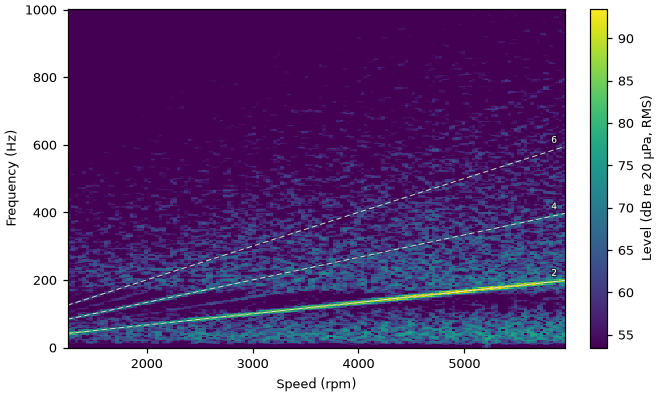

```python
fmap = ro.maps.rpm_frequency_map(x2, FS, rpm2, resolution=4.0, amplitude="rms", max_freq=1000.0)
ax = rp.rpm_frequency_map(fmap, **rp.SOUND_PRESSURE, mark_orders=(2, 4, 6))
```

### rpm_order_map

The order map of the same pull: orders are horizontal lines, and what has a fixed frequency bends into a hyperbola. Here that is the rumble (20 to 60 Hz), the fan at the lowest orders: orders 1 to 3 at 1200 rpm, below order 0.6 at 6000 rpm. A map cell reads the level of its bin; read the level of an order with `order_slice`, which sums the power over a band.

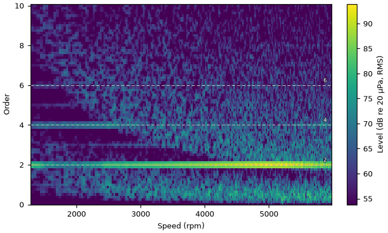

```python
omap = ro.maps.rpm_order_map(x2, FS, rpm2, order_resolution=0.125, max_order=10.0, amplitude="rms")
ax = rp.rpm_order_map(omap, **rp.SOUND_PRESSURE, mark_orders=(2, 4, 6))
```

### compare_maps

Maps side by side on one colour scale, so equal colours mean equal levels, with the dict keys as titles: the order maps of the electric drive before and after lowering the whine by 10 dB. The rumble at the lowest orders is 35 to 55 dB above the whine, so the colour range is 70 dB (`dynamic_range=70`); it shows the motor orders (2 to 14 and the gear mesh 6.7) and the whine at order 40, brightest where it passes the resonance at 4350 rpm. `difference=True` adds the level difference to the first map on a diverging scale centred on 0 dB: about -10 dB along order 40 and 0 dB everywhere else. Below about 1500 rpm the 20 Hz band of the Vold-Kalman filter spans more than one order (1.2 orders at 1000 rpm), so the neighbouring cells change too. The difference scale spans the 99.5th percentile of the absolute differences over the cells that are shown (at least one map above the bottom of the colour scale), so a few noise cells with a large difference saturate instead of stretching it, and arrows on the colour bar show that some cells lie beyond it (`difference_range=` sets it). If the order of interest is below the bottom of the colour scale (a low-order rumble dominates and `dynamic_range` is too small), no shown cell changes; the scale is then set by the changed cells near their own row maximum, and a `UserWarning` suggests a larger `dynamic_range`. Here the whine at the lowest speeds lies below the 70 dB range and the gallery script silences that warning. The maps may also be of different domains, for example a Campbell diagram next to the order map of the same run, on one colour scale.


```python
okw = {"order_resolution": 0.125, "max_order": 44.0, "amplitude": "rms"}
ev_omap, ev_omap_y = (ro.maps.rpm_order_map(s, FS, rpm_ev, **okw) for s in (ev.x, y))
fig, _ = rp.compare_maps({"original": ev_omap, "order 40 -10 dB": ev_omap_y}, **rp.SOUND_PRESSURE,
                         difference=True, dynamic_range=70, figsize=(9.0, 3.2))
```

## Slices, spectra, levels, metrics

### order_slice

The level of orders 2 and 4 of the engine against speed, each with the truth of the scenario (`truth=`, in the same convention as the slice: the quasi-static RMS amplitude at the receiver, the source order times the path response). For a dict of slices, `truth` can be a dict with the same keys: each truth is drawn thin and dashed in a lighter shade of its slice's colour, on top of the slice, and labelled "<key> truth". Order 2 follows its truth within 0.23 dB (median), through the 45 Hz hump at 1350 rpm, the trough near 1800 rpm and the 175 Hz hump (93.6 dB at 5090 rpm, the maximum of the truth; the slice drawn peaks at 94.0 dB at 5137 rpm). Order 4 follows its truth up to about 2700 rpm; above, it is weaker than the broadband noise in its order band, and the slice reads that noise, about 8 dB above the truth (median above 2700 rpm). The truth shows where a slice can be trusted.

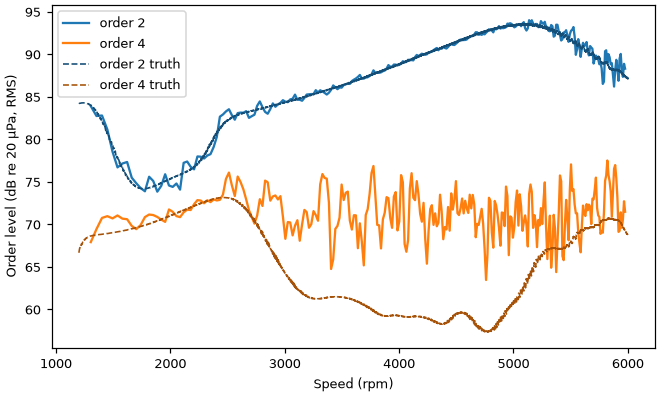

```python
s2, s4 = ro.slices.order_slice(omap, 2.0), ro.slices.order_slice(omap, 4.0)
truth2, truth4 = order_truth(ice, 2.0)[second], order_truth(ice, 4.0)[second]  # RMS, Pa
ax = rp.order_slice({"order 2": s2, "order 4": s4}, **rp.SOUND_PRESSURE,
                    truth={"order 2": (rpm2, truth2), "order 4": (rpm2, truth4)})
```

where `order_truth(sc, order)` is `sc.quasi_static_amplitude(k) / np.sqrt(2.0)` for the column `k` of that order in `sc.orders`.

### order_slice with relative_to

The before/after view: every entry of the dict minus the one named by `relative_to`, in dB. The whine of the modified signal sits at -9.95 dB (median; -10.0 to -9.8 dB) up to 4500 rpm. Above, the whine is weak against the noise of its order band (see `order_prominence`), and the slice also holds noise that the extraction did not take, since the order band of the slice is wider in Hz than the 20 Hz band of the Vold-Kalman filter at high speed: the median is -9.6 dB from 4500 to 7500 rpm and -8.4 dB above, with single frames up to -1.8 dB. No reference is needed for a difference.

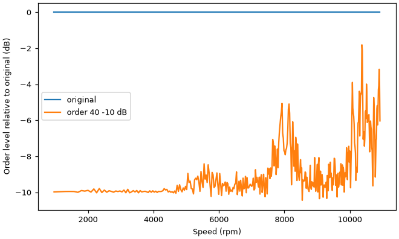

```python
s40, s40_y = ro.slices.order_slice(ev_omap, WHINE), ro.slices.order_slice(ev_omap_y, WHINE)
ax = rp.order_slice({"original": s40, "order 40 -10 dB": s40_y}, relative_to="original")
```

### frequency_slice

The level of one fixed frequency against speed, from the Campbell diagram of the electric drive: the 6.3 kHz tone, at 29.8 dB re 20 µPa at the receiver (the truth, from the tone stem of the scenario and the path response). Below 3000 rpm the slice reads the truth to 0.01 dB (median); above, the road noise in the 4 Hz bin rises with speed and the slice scatters by -1.4 to +2.68 dB (5th to 95th percentile). The peak of 38.4 dB at 9470 rpm is the whine crossing 6.3 kHz (40 × 9450 / 60 = 6300 Hz).

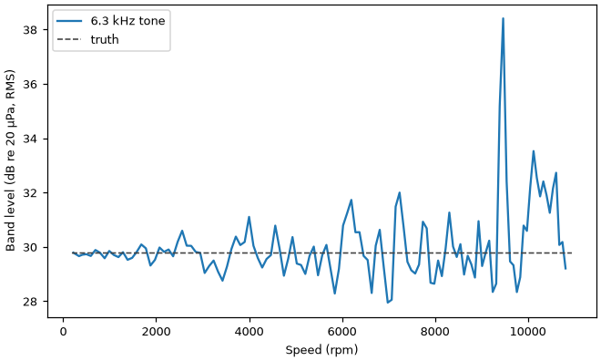

```python
ev_fmap = ro.maps.rpm_frequency_map(ev.x, FS, rpm_ev, resolution=4.0, amplitude="rms", max_freq=8000.0)
tone = ro.slices.frequency_slice(ev_fmap, TONE)
tone_rms = np.full_like(rpm_ev, tone_truth(ev, TONE))
ax = rp.frequency_slice({"6.3 kHz tone": tone}, **rp.SOUND_PRESSURE, truth=(rpm_ev, tone_rms))
```

### order_spectrum

The energy average of the order map of the engine's second-gear pull, against order, with the firing order and its harmonics marked. Each point is the level of one bin: order 2 at 90.0 dB, order 4 at 69.5 dB, orders 6 and 8 small peaks on the broadband (61.6 and 58.8 dB); below order 1.5 the rumble raises the floor.

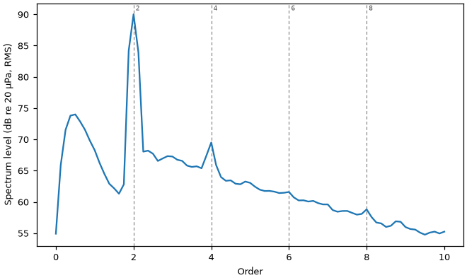

```python
spec = ro.slices.order_spectrum(omap)
ax = rp.order_spectrum(spec, **rp.SOUND_PRESSURE, mark_orders=(2, 4, 6, 8))
```

### overall_level

The A-weighted overall level of the electric drive per speed bin (250 rpm), before and after: from 50.8 to 70.4 dB re 20 µPa over the run. Lowering the whine by 10 dB lowers the A-weighted level by 1.9 dB at the resonance (4250 to 4500 rpm), by at most 0.4 dB below 3000 rpm and by less than 0.03 dB above 5500 rpm: the tonal complaint is local, and the overall level hardly shows it elsewhere. The label names the weighting and the reference.

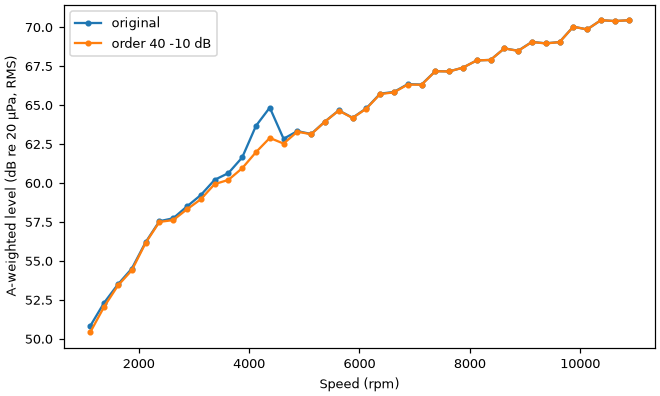

```python
ol = ro.slices.overall_level(ev.x, FS, rpm_ev, weighting="A", rpm_bins=EV_EDGES)
ol_y = ro.slices.overall_level(y, FS, rpm_ev, weighting="A", rpm_bins=EV_EDGES)
ax = rp.overall_level({"original": ol, "order 40 -10 dB": ol_y}, **rp.SOUND_PRESSURE)
```

`overall_level` stores levels, so the default `ref=None` draws them as stored and the label states the stored reference as a number ("dB re 2e-05"); `**rp.SOUND_PRESSURE` gives the same numbers labelled "dB re 20 µPa".

### metric_vs_rpm

A metric aggregated in speed bins, with its spread (± one standard deviation, or the interquartile range for a median or a percentile) as a band; bins with too few samples are gaps. Normally the metric comes from a psychoacoustic toolbox through `rota_order.bridges` (`bridges.mosqito.loudness(x, fs).vs_rpm(rpm, t)`). This gallery needs no toolbox: the metric is the A-weighted level with Fast time weighting computed by rota-order (`rota_order.tonal.level_vs_time`), wrapped in a `TimeMetric` by hand with a 0.5 s start-up exclusion and the energy mean as aggregation. Here it is the electric drive in 250 rpm bins, from 49.5 to 70.4 dB, with the bump of the whine at the resonance (64.1 dB at 4375 rpm). The drive sweeps a bin in about 0.17 s, so a bin holds 3 to 5 values and the band is narrow; the start-up exclusion ends below the first bin.

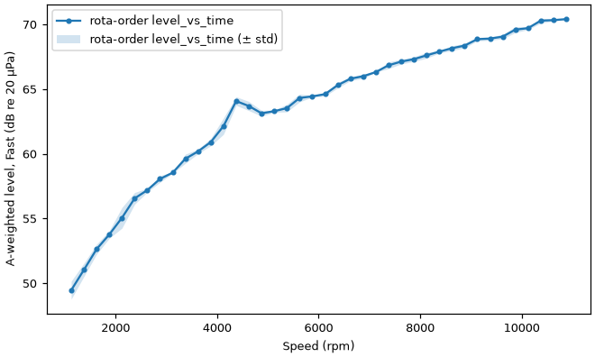

```python
ev_level = a_weighted_level(ev.x).vs_rpm(rpm_ev, ev.t, bins=EV_EDGES)
ax = rp.metric_vs_rpm(ev_level)
```

where the function `a_weighted_level` of the script does, in short:

```python
t, level = ro.tonal.level_vs_time(ro.tonal.weight(x, FS, "A"), FS, frame=0.05)
TimeMetric(name="A-weighted level, Fast", t=t, values=level, unit="dB re 20 µPa",
           skip_start=0.5, aggregate="power", source="rota-order level_vs_time")
```

### time_metric

A `TimeMetric` against time: the same A-weighted Fast level, of the whole engine run-up. It rises from 69.9 dB at 1 s to a maximum of 82.9 dB at 12.5 s and dips by less than 1 dB after each upshift (9.2 and 15.2 s). The start-up exclusion (`skip_start`, here 0.5 s from the first value) is shaded: a time-weighted meter starts at zero and reads low for a few time constants.

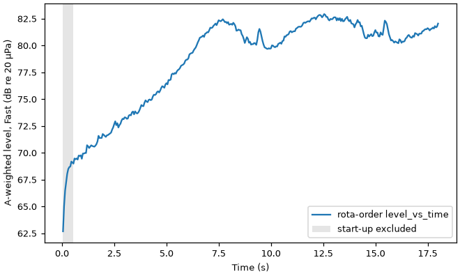

```python
level = a_weighted_level(ice.x)
ax = rp.time_metric(level)
```

## Speed, extraction, tonal

### rpm_vs_time

A speed given as arrays, here the engine speed from the tachometer (`tacho_to_rpm`, 60 pulses per revolution), with the true mean speed of the scenario as the reference: second gear to 6000 rpm, the upshifts at 9.2 and 15.2 s, and third and fourth gear. The tachometer reads the truth to 0.015 % (median) and 0.084 % at most. A reference (and a single `truth=` curve of the slice figures) is drawn in one neutral style: thin, dark grey, dashed, on top of the data.

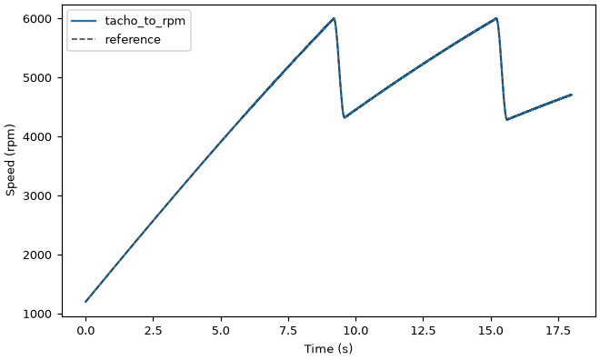

```python
t, rpm = ice.t, tacho_rpm(ice)
ax = rp.rpm_vs_time(t, rpm, label="tacho_to_rpm", reference=(t, ice.rpm_mean))
```

where `tacho_rpm(sc)` is `rota_order.speed.tacho_to_rpm(sc.tacho, FS, ppr=..., t_out=sc.t + delay)` with the pulse count and the conditioning delay of the scenario.

### rpm_from_ridge

The tacholess speed track of the same run-up with the frames that must not be trusted, from the signal alone with the comb of a four-cylinder engine, orders 2, 4 and 6 (the firing order and its harmonics). It follows the second-gear pull and both upshifts: 0.32 % from the truth (median), 1.5 % at the 95th percentile, at most 2.2 % outside the shifts and up to 9 % inside the second one, where the speed drops by 30 % in 0.4 s. Black crosses mark the 21 frames (6 %) whose `confidence` is below 0.1, 9 of them in the shifts. A frame flagged `at_bound` (the track at an end of the search range, here 700 to 7000 rpm) would get an open dark-red circle and the search range would be drawn dotted; no frame is flagged here. The marker colours are fixed, not taken from the colour cycle. Read the two markers together: a wrong track can have a high confidence. `label=` sets the legend text of the track.

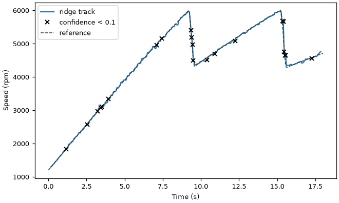

```python
ridge = ro.speed.rpm_from_ridge(ice.x, FS, (700.0, 7000.0), orders=(2, 4, 6))
ax = rp.rpm_from_ridge(ridge, reference=(t, ice.rpm_mean))
```

### order_components

The envelope of an extracted order against speed: the whine of the electric drive from the Vold-Kalman filter. Extractors return peak envelopes, and the label says "peak". The components carry samples, not speeds, so the speed is passed as `rpm=`. The whine peaks at 64 dB at 4300 rpm, where it passes the resonance (truth: 64.1 dB peak at 4330 rpm); the slow humps above it are its amplitude modulation (a scenario default). Below about 2500 rpm and in the deepest troughs the whine is near the noise in the 20 Hz band of the filter, and the envelope is ragged.

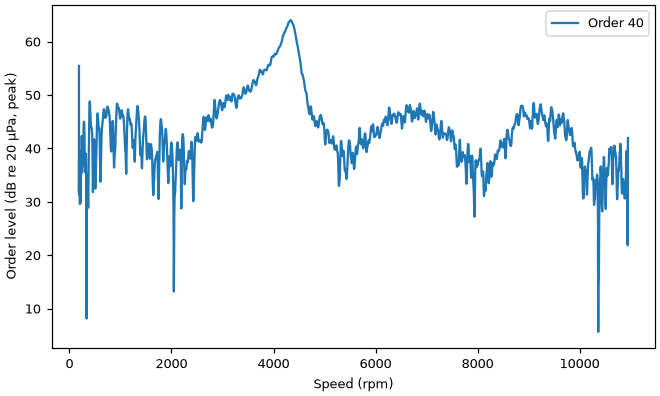

```python
resid, whine = ro.extract.residual(ev.x, FS, rpm_ev, [WHINE], method="vold-kalman", bandwidth=20.0)
ax = rp.order_components(whine, rpm=rpm_ev, **rp.SOUND_PRESSURE)
```

### order_table

The rows of an `OrderTable` against its speed grid, here built from the slices of the firing order and its harmonics of the engine in 250 rpm steps; the input of `rota_order.resynth.synthesize_orders`. The table keeps the convention of the slices (RMS) and its unit (Pa). Like the slices, rows 4 and 6 hold the broadband noise of their order bands above about 2700 rpm: a table measured from a recording carries what the slices read.

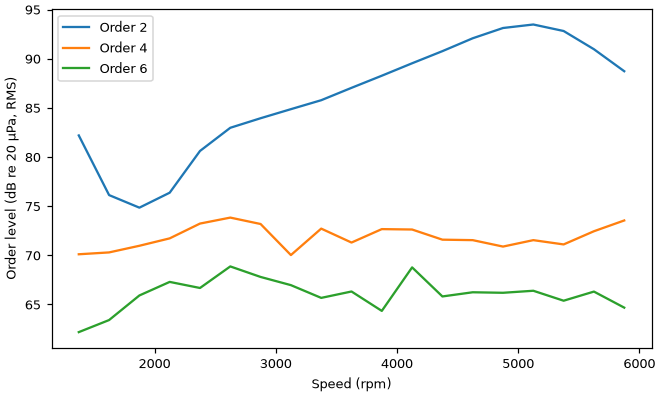

```python
table = ro.resynth.OrderTable.from_slices(
    [ro.slices.order_slice(omap, o) for o in (2.0, 4.0, 6.0)], EDGES[:-1] + 125.0, unit="Pa"
)
ax = rp.order_table(table, **rp.SOUND_PRESSURE)
```

### order_prominence

The tone-to-noise ratio of the whine of the electric drive against speed (`kind="pr"` for the prominence ratio), with the ECMA-418-1 criterion dashed in its colour and the speed range where the order is prominent shaded. Above 1 kHz the criterion is 8 dB; the whine reaches it at about 3000 rpm and stays above it to about 4600 rpm, with a maximum of 22.0 dB at 4300 rpm (2870 Hz, at the resonance). Above 5000 rpm the ratio stays below 6 dB. The points are frames (10 revolutions) that lie entirely above `min_rpm=1500` (the first at about 1900 rpm, since the drive accelerates fast), so the shading is continuous; with `rpm_bins=` a point stands for its bin, and consecutive prominent bins are shaded as one range. A bin without frames has no point: a single empty bin between two prominent bins is bridged, a gap of two or more bins, or a bin with a point below the criterion, stays open. The result holds one set of frames for all orders, with the frame length that the lowest order needs; for the speed resolution of a high order next to a low one (6.7 and 40, say) call `ro.tonal.order_prominence` once per order and draw the results one after the other (`ax=`), see its docstring. Prominence here is the objective criterion only; the aural check of the standard is not assessed.

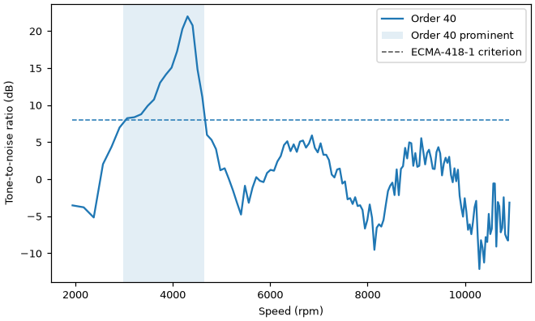

```python
prom = ro.tonal.order_prominence(ev.x, FS, rpm_ev, [WHINE], min_rpm=1500.0)
ax = rp.order_prominence(prom)
```

### band_levels_vs_rpm

1/3-octave band levels of the engine's second-gear pull against speed, as an image on the band limits (logarithmic frequency axis, nominal mid-band frequencies as labels). The colour is the RMS level of the whole band, not a spectral density. The firing order climbs through the bands from 40 Hz to 200 Hz and is brightest in the 160 Hz band around 5000 rpm (the 175 Hz path hump); the rumble fills the bands up to 63 Hz, and the combustion bursts ringing at 1.9 kHz lift the 2 kHz band as the speed rises.

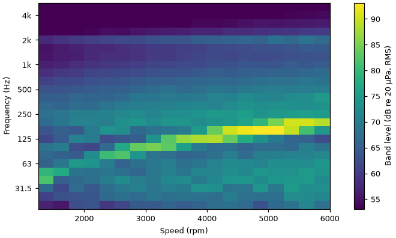

```python
bands = ro.tonal.band_levels_vs_rpm(x2, FS, rpm2, rpm_bins=EDGES, frame=0.1, fmax=5000.0)
ax = rp.band_levels_vs_rpm(bands, **rp.SOUND_PRESSURE)
```

## References

Every function lists its references in its docstring. For the figures as such: Brandt, A. (2011). *Noise and Vibration Analysis*, ch. 12. Wiley. Hunter, J. D. (2007). Matplotlib: A 2D graphics environment. *Computing in Science & Engineering*, 9(3), 90-95. Crameri, F., Shephard, G. E., & Heron, P. J. (2020). The misuse of colour in science communication. *Nature Communications*, 11, 5444. Ecma International (2024). ECMA-418-1, *Psychoacoustic metrics for ITT equipment - Part 1 (prominent discrete tones)*, 3rd edition.
