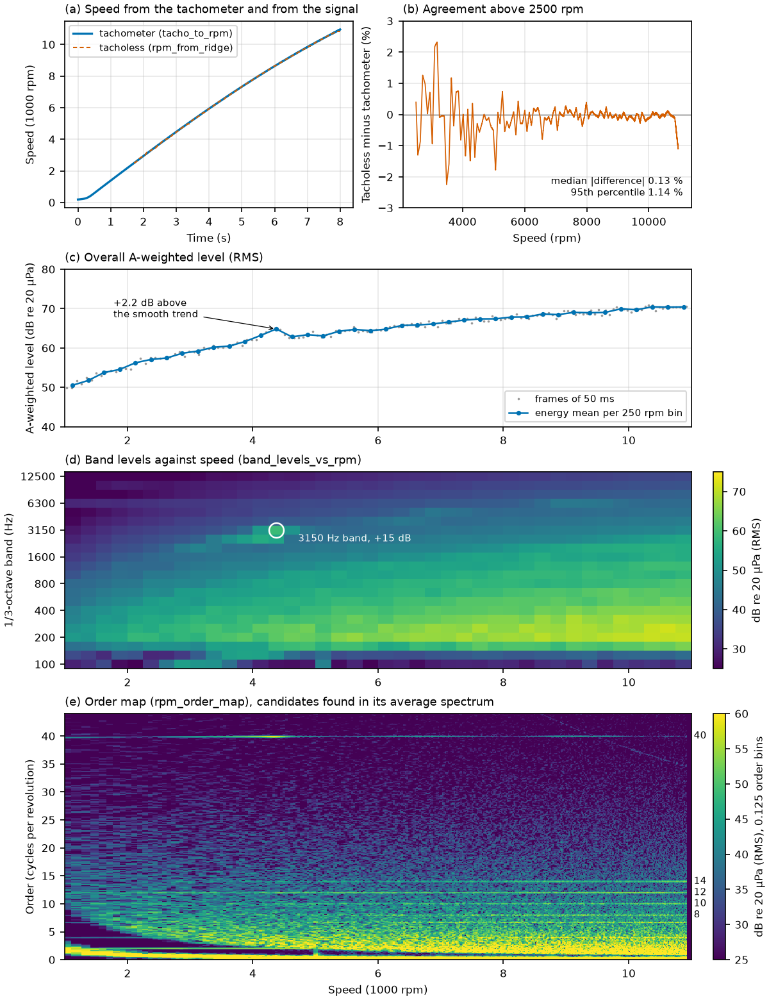
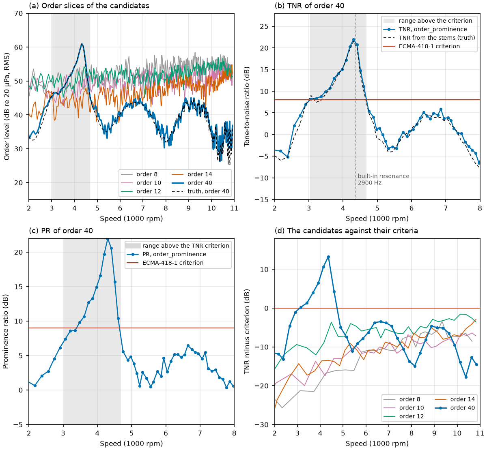

# A worked analysis: from a run-up recording to an engineering conclusion

This page follows one analysis from the raw signal to a statement an engineer can act on:

> The gear whine, order 40, is prominent between about 3.0 and 4.7 krpm (2.0 to 3.1 kHz) and more than 6 dB above the ECMA-418-1 criterion between 3.8 and 4.5 krpm. It exceeds the criterion by up to 14 dB, at 4.3 krpm. About 15 dB less at that order brings it under the criterion. That lowers the A-weighted level in the range by 1.05 dB, the loudness by 8.6 %, and the ECMA-418-2 tonality by 69 %.

The script is [examples/10_worked_analysis.py](https://github.com/ZhenxianLi/rota-order/blob/main/examples/10_worked_analysis.py). It runs in about 75 s on four cores with the two optional toolboxes (about 20 s without them), prints every number quoted below, and writes the three figures and three WAV files linked here. All numbers on this page are its output.

The recording is synthetic: `rota.synth.synth_scenario("ev_runup")`, seeded. Nothing is measured. That is deliberate: the signal has an exact truth, so each step of the analysis can be compared with what was put into the signal, and the page does that in a table at the end. The analysis itself does not use the truth. It finds the order, the speed range and the size of the problem from the signal alone.

## 0. The recording and the problem we built in

The recording is an electric drive, 8 s at 32 kHz, one channel: a motor with four pole pairs behind a 12:1 reduction, accelerating at full load from walking pace to 109 km/h (200 to 10900 rpm). The sources are the motor orders 2, 4, 8, 10, 12 and 14, a gear-mesh order 6.7, the gear whine at order 40 (the tooth count of the reduction gear) with a slow amplitude modulation, an inverter carrier at 10 kHz with sidebands, two fixed tones, road noise, a low-frequency rumble, a thump and a click. The tonal lines are weak against the broadband, as in a quiet electric vehicle. The signal is sound pressure in Pa; levels are in dB re 20 µPa.

With the default parameters of the scenario no order is prominent: the closest, order 40, is 2.6 dB below its TNR criterion (the script checks this). A tonal complaint therefore needs a problem, and the script builds one in, stated here and in the script as `PROBLEM_MODE` and `CABIN`:

| Change to the defaults of `synth_scenario` | Value | Why |
|---|---|---|
| A structural resonance is added to the transfer path (`path.modes`, on top of the default modes) | 2900 Hz, quality factor 20, static gain 0.5 | The whine, order 40, is amplified when it passes 2900 Hz, which is at 4350 rpm. Half-power band of the resonance: 4241 to 4459 rpm. |
| The cabin has no diffuse-field fading up to 7.9 kHz (`cabin.crossover_hz`) | 7900 Hz | With the default cabin the level of every order above about 340 Hz also fades in and out by several dB over tens of Hz, which hides the resonance behind a ragged curve. |
| Tachometer pulses per revolution (`tacho.ppr`) | 24 | The default 48 pulses would be shorter than 2 samples at 32 kHz above 10000 rpm. |

The static gain of the added mode also raises the modal path gain below the resonance, by 2.7 to 3.6 dB between 100 Hz and 2 kHz (printed by the script). Everything else is a default. In the rest of the page, "the problem we built in" means the whine at order 40 passing a resonance at 2900 Hz.

## 1. Preparation

The speed comes from the tachometer channel with `tacho_to_rpm` (the conditioning delay of the tachometer is compensated). It is checked against the true speed, and against a tacholess estimate from the signal alone, `rpm_from_ridge`, with a comb of the orders of the drive:

```
Speed from the tachometer (tacho_to_rpm, delay compensated) against the true mean speed: median 0.0052 %, 95th percentile 0.118 %
Tacholess speed (rpm_from_ridge, comb of orders 2, 4, 6.7, 8, 10, 12, 14, 40, search range 2000 to 11500 rpm, window 0.2 s, moving): reliable True, frames at a bound 0
  against the tachometer above 2500 rpm: median |difference| 0.125 %, 95th percentile 1.14 %, maximum 2.32 %
to_calibrated_48k: 32000 -> 48000 Hz, RMS 87.71 -> 87.71 dB re 20 uPa (calibration factor 1, the signal is in Pa)
```

The two speeds agree to 0.13 % (median) above 2500 rpm. Below about 2500 rpm the tonal lines lie under the road noise and the rumble, and the tacholess estimate has nothing to follow, so the search range starts at 2000 rpm and the tachometer is the reference for everything below. The rest of the analysis uses the tachometer speed. `to_calibrated_48k` makes the 48 kHz copy that the toolboxes and the WAV files need; the polyphase filter leaves the level unchanged (87.71 dB before and after).

## 2. Overview



*Figure 1. (a, b) Speed from the tachometer and from the signal, and their difference. (c) Overall A-weighted level against rpm (`overall_level`). (d) 1/3-octave band levels against rpm (`band_levels_vs_rpm`). (e) Order map (`rpm_order_map`) with the candidate orders found in its average spectrum.*

Three views, from the least to the most specific:

```
A-weighted level in 250 rpm bins: 50.6 dB at 1125 rpm to 70.5 dB at 10375 rpm; largest departure from a smooth cubic fit +2.16 dB at 4375 rpm (frames of 50 ms)
1/3-octave band levels in the same bins (100 to 12500 Hz): among the bands from 500 Hz, the one that rises most above the median of its neighbouring speed bins (+-3) is 3150 Hz at 4375 rpm, +15.3 dB (level 58.9 dB re 20 uPa)
Order map (0.125 order bins, RMS): peaks of the average order spectrum 2500 to 11000 rpm at least 6 dB above the running median: 8 (+7 dB), 10 (+7 dB), 12 (+12 dB), 14 (+11 dB), 39.875 (+21 dB)  ->  candidate orders 8, 10, 12, 14, 40 (the peaks are rounded to the nearest half order)
  weaker peaks, 2 to 6 dB, are not taken as candidates: 2 (+3 dB), 4 (+2 dB), 6.75 (+5 dB)
```

* The overall A-weighted level (panel c) rises with speed from 50.6 to 70.5 dB. At 4.4 krpm it stands 2.2 dB above a smooth trend. That is a hint, not a diagnosis: a broadband resonance would look the same.
* The 1/3-octave bands (panel d) say where in frequency: the 3150 Hz band rises 15.3 dB above the same band at neighbouring speeds, at 4375 rpm. The bands below 500 Hz are left out of this search, because the rumble and the thump (a transient at 3.4 s, near 5000 rpm) make them fluctuate by several dB between bins. A band level does not say whether the excess is a tone, or whether it follows the shaft.
* The order map (panel e) does: the energy sits on horizontal lines, which means orders, and one of them, near order 40, brightens around 4.3 krpm. The candidate orders are the peaks of the average order spectrum (`order_spectrum`, 2500 to 11000 rpm) that stand at least 6 dB above its running median: 8, 10, 12, 14 and one at 39.875, which is order 40 within the 0.125 resolution of the map. (It reads 0.06 order low. This is consistent with the sound reaching the receiver 5 ms after the shaft angle that produced it, while the order sweeps at about 1000 Hz/s.) The weaker lines at 2, 4 and 6.75 (6.7 is the gear mesh) stand 3 to 5 dB above the median and are not taken as candidates; the map shows the 6.75 line faintly.

## 3. Diagnosis



*Figure 2. (a) Order slices (`order_slice`) of the candidates, with the quasi-static truth for order 40 (dashed). (b) TNR of order 40 against the ECMA-418-1 criterion, with the TNR computed from the stems of the scenario (dashed). The grey band is the range above the criterion. (c) Prominence ratio. (d) TNR minus criterion of every candidate.*

`order_prominence` evaluates the tone-to-noise ratio (TNR) and the prominence ratio (PR) of an order along the run-up, following ECMA-418-1, 3rd edition (2024). It resamples to uniform shaft angle, so the order is one stationary line in every frame although the speed rises by up to 1500 rpm/s, and it evaluates the critical band at the mean speed of each frame. `prominence_criterion` gives the criterion, which is 8 dB for the TNR and 9 dB for the PR above 1 kHz.

The frame length follows the line spacing the standard requires for each order, so the low orders get long frames and a coarse resolution in rpm. The five candidates, screened in 250 rpm bins:

| Order | Frame (revolutions) | Largest TNR minus criterion | Largest PR minus criterion | Slice maximum (dB re 20 µPa) |
|---|---|---|---|---|
| 8 | 45 | -3.4 dB at 9337 rpm | -7.3 dB | 58.4 |
| 10 | 37 | -6.4 dB at 10646 rpm | -8.7 dB | 55.3 |
| 12 | 31 | -1.6 dB at 10135 rpm | -5.2 dB | 56.9 |
| 14 | 26 | -2.9 dB at 10826 rpm | -7.5 dB | 54.9 |
| **40** | 10 | **+13.3 dB at 4355 rpm** | **+12.3 dB** | 60.9 |

Four orders lie 1.6 to 6.4 dB under their criterion everywhere, although their order slices (panel a, 55 to 58 dB at the maximum) are about as high as the peak of the whine (60.9 dB): the slice of a line that stands in the noise reads the noise as well, and the TNR compares the line with it. Only order 40 exceeds the criterion. A second view agrees: with `order_share`, the strongest narrowband line of each frame of the Campbell diagram (20 Hz bins, 300 to 9000 Hz, at least 6 dB above its local median) lies on order 40 in 49 % of all frames, and in 98 % of the frames in the range found below (the fixed 6.3 kHz tone, which is on no order, takes 30 % of the frames, 83 % of them below 3034 rpm). Order 12 takes 9 % and order 14 4 % of all frames, in none of them in the range. The control order 34, which has no source, takes 0 %.

Order 40 alone gets the short frames its frequency allows (10 revolutions, 0.1 order line spacing) and 100 rpm bins:

```
  TNR above the ECMA-418-1 criterion between 3034 and 4685 rpm (2023 to 3123 Hz), maximum 22.0 dB against 8.0 dB, i.e. +14.0 dB at 4304 rpm; more than 6 dB above it between 3846 and 4530 rpm
  PR above its criterion between 3391 and 4648 rpm, maximum +12.9 dB at 4304 rpm; tone wider than 15 % of the critical band in 14 of 85 bins
     rpm    Hz |   TNR  crit excess  truth |    PR  crit excess
    2908  1938 |   7.0   8.0   -1.0   -1.2 |   6.1   9.0   -2.9
    3211  2140 |   8.4   8.0   +0.4   -0.5 |   8.6   9.0   -0.4
    3486  2324 |   9.9   8.0   +1.9   +1.2 |   9.8   9.0   +0.8
    3739  2493 |  13.0   8.0   +5.0   +3.9 |  12.7   9.0   +3.7
    3976  2650 |  15.1   8.0   +7.1   +6.9 |  14.9   9.0   +5.9
    4198  2798 |  20.3   8.0  +12.3  +11.7 |  19.7   9.0  +10.7
    4407  2938 |  20.7   8.0  +12.7  +12.0 |  20.6   9.0  +11.6
    4606  3071 |  11.1   8.0   +3.1   +2.0 |  10.4   9.0   +1.4
```

The result is a curve, not a point. The order is prominent between 3.0 and 4.7 krpm, but the first 450 rpm of that range are only 0 to 2 dB over the criterion; the part that matters is 3846 to 4530 rpm, where the excess is more than 6 dB, with the maximum of +14.0 dB (TNR 22.0 dB against 8.0 dB) at 4304 rpm, where the whine is at 2870 Hz. The excess of the PR is smaller (+12.9 dB). The TNR sets the reduction needed.

The "truth" column is the TNR computed from the stems of the scenario: the tone is the quasi-static amplitude of order 40 at the receiver (`ScenarioSignal.quasi_static_amplitude`, RMS), the noise is the power spectral density of everything else (`x_clean` minus the whine stem), averaged over the critical band. Near the range the measured TNR is 0.55 dB above it on average and at most 1.09 dB. The order slice (`order_slice`, RMS) agrees with the quasi-static truth to -0.03 dB (median), at most 0.82 dB, over the 35 frames of the range: 60.9 dB against 61.1 dB at the maximum.

What the standard asks of a listener is not assessed. ECMA-418-1 calls a tone prominent when its ratio reaches the criterion and it is audible (an aural examination); the criterion is the objective part only.

## 4. Extraction and what-if

The order is extracted with the second-generation Vold-Kalman filter (`order_waveform`, through `extract.residual`, which also returns the residual: the signal minus the order). Its bandwidth is a trade-off, and `resolution_check` states one limit of it: the filter must separate the order from its neighbours. The other limit is that the filter must follow the changes of the amplitude: the whine passes the resonance within about 0.15 s, and a bandwidth B follows changes with a time constant of about 0.18/B s.

```
resolution_check, Vold-Kalman bandwidth 20 Hz (pass band 40 Hz) against the candidates 8, 10, 12, 14, 40: all pairs with order 40 resolved True; nearest is order 14, at least 81 Hz away, largest admissible bandwidth 40 Hz
extracted order 40 against its true stem through the path: correlation 0.9903, nrmse 0.140; RMS level in the range 54.38 dB (truth 54.42 dB); residual 87.7 dB re 20 uPa overall
  other bandwidths, order resolved from its neighbours / correlation with the true stem: 10 Hz: yes / 0.9927; 20 Hz: yes / 0.9903; 30 Hz: yes / 0.9861; 50 Hz: no / 0.9770
```

The nearest candidate, order 14, is at least 81 Hz away, so the largest admissible bandwidth is 40 Hz. The script takes 20 Hz, half of that: a time constant of 9 ms, a pass band of 40 Hz. Between 10 and 30 Hz the extraction hardly changes (correlation with the true stem 0.993 to 0.986; 10 Hz is slightly better on this signal); at 50 Hz the check fails and the correlation drops. The extracted order has the right level: 54.38 dB in the range against 54.42 dB for the true stem.

The what-if lowers the extracted order with `modify_orders(gain_db={40: -R})` and adds the residual back with `resynthesize`. The result is the original plus `(gain - 1)` times the extracted order, exactly (the script asserts it). Then it is analysed again, with the same functions. The reduction follows from the diagnosis: the TNR falls by the dB that the tone falls by, so the excess of 14.0 dB calls for 14 dB. Checked, it is not quite enough:

```
Reduction needed to reach the criterion: the larger of the TNR and PR excess, +14.0 dB, rounded up to 14 dB (truth: +13.5 dB). What-if, each checked with the same analysis:
  order 40 reduced by 14 dB: largest remaining excess +0.9 dB
  order 40 reduced by 15 dB: largest remaining excess -0.1 dB
```

With 14 dB the excess left is +0.9 dB. The verification below shows why: with 15 dB the order slice falls by 14.89 dB, but the TNR only by 14.1 dB. The extracted order carries the noise of its 40 Hz pass band with it, so the noise estimate of the TNR falls by about 0.8 dB as well, and the reduction has to exceed the excess by about a dB. With 15 dB the criterion is reached, with 0.1 dB to spare. That is the minimum: a design target would carry a margin. The script also tries a round value, 10 dB, which is the kind of number a first guess gives:

```
  original : order-40 slice  +0.00 dB in the range; TNR excess maximum  +14.0 dB (PR  +12.9 dB), prominent range 3034 to 4685 rpm; L_A in the range 62.15 dB (+0.00 dB)
  required : order-40 slice -14.89 dB in the range; TNR excess maximum   -0.1 dB (PR   -1.1 dB), prominent range none; L_A in the range 61.11 dB (-1.05 dB)
  round    : order-40 slice  -9.95 dB in the range; TNR excess maximum   +4.7 dB (PR   +3.3 dB), prominent range 4103 to 4461 rpm; L_A in the range 61.19 dB (-0.96 dB)
  required : A-weighted level, largest change of the 250 rpm bins -2.28 dB at 4375 rpm (from 64.8 dB)
  round    : A-weighted level, largest change of the 250 rpm bins -2.07 dB at 4375 rpm (from 64.8 dB)
```

The order slice drops by 14.89 and 9.95 dB, as applied. Ten dB is not enough: the order stays prominent between 4103 and 4461 rpm, with +4.7 dB at the maximum. The A-weighted level changes by about the same in both cases (-1.05 and -0.96 dB, energy mean over the range), because the A-weighted level is dominated by the broadband and the first 10 dB take most of the whine's energy.

`modify_orders` scales the order over the whole run, not only near the resonance. Here that does no harm to the conclusion, since the order is below its criterion everywhere else (figure 2d), but a real fix, such as more damping at the resonance, acts only near it.

## 5. Psychoacoustics

ROTA computes none of the psychoacoustic metrics; it prepares the signal and the speed, and bins the time-varying results of the toolboxes along rpm (`metric_vs_rpm`). This step uses two optional, open-source packages through their documented public functions. ROTA does not import or copy them; without a package the script prints which part it skipped (`pip install mosqito`, `pip install sottek-hearing-model`) and the tests for that part are skipped. Other open-source implementations are catalogued at [zhenxianli.github.io/LISQM](https://zhenxianli.github.io/LISQM/); [examples 07](https://github.com/ZhenxianLi/rota-order/blob/main/examples/07_mosqito_bridge.py) and [08](https://github.com/ZhenxianLi/rota-order/blob/main/examples/08_sottek_hearing_model_bridge.py) describe the two bridges in detail.

* MoSQITo 1.2.1 (Apache-2.0): `loudness_zwtv` (ISO 532-1:2017, time-varying, free field) and `sharpness_din_from_loudness` (DIN 45692).
* The Sottek hearing model, `sottek-hearing-model` 0.1.14 (AGPL-3.0-only, Python 3.11 or later; install it only if you accept the licence): `shm_tonality_ecma`, the ECMA-418-2:2025 (4th edition) tonality. Its dominant tonal frequencies are attributed to order 40 with `frequency_to_order` (10 % window), as in example 08.

Editions: ROTA's prominence follows ECMA-418-1, 3rd edition (2024). The Sottek model implements ECMA-418-2, 4th edition (2025). The ECMA-418-2 functions of MoSQITo 1.2.1 are of the 2nd edition (2022) and are not used here.

`metric_vs_rpm` bins each metric in 250 rpm bins with the aggregation that suits it: the 95th percentile of the loudness (N5), the median of the sharpness, the mean of the tonality frames above 0.02 tu_HMS. The start-up of each model is skipped (0.6 s, 0.3 s). Metrics are never averaged in dB. The three signals are the original and the two reduced versions.


*Figure 3. The original (blue), order 40 reduced by 15 dB (orange) and by 10 dB (green). (a, b) The order slice and the TNR minus criterion, ROTA. (c) Change of the A-weighted level, ROTA. (d) Change of the loudness N5, MoSQITo. (e) Change of the sharpness, MoSQITo. (f) Tonality, Sottek model: overall (solid) and the part attributed to order 40 (dashed). The grey band is the range above the TNR criterion.*

```
    rpm |     N5  d -15 dB  d -10 dB |      S  d -15 dB  d -10 dB
   3125 |  13.07    -0.318    -0.268 |   1.14    -0.014    -0.014  <- in the range
   3375 |  14.07    -0.561    -0.499 |   1.13    -0.022    -0.018  <- in the range
   3625 |  14.94    -0.682    -0.590 |   1.13    -0.028    -0.024  <- in the range
   3875 |  15.92    -1.052    -0.870 |   1.15    -0.035    -0.029  <- in the range
   4125 |  18.07    -2.201    -1.803 |   1.19    -0.085    -0.068  <- in the range
   4375 |  19.46    -2.955    -2.412 |   1.24    -0.136    -0.111  <- in the range
   4625 |  18.55    -1.996    -1.627 |   1.10    -0.006    -0.007  <- in the range
    rpm | tonality original   tonality -15 dB   tonality -10 dB | order 40 original   order 40 -15 dB   order 40 -10 dB
   3125 |             0.572             0.247             0.248 |             0.572             0.009             0.074  <- in the range
   3375 |             0.734             0.259             0.261 |             0.734             0.007             0.121  <- in the range
   3625 |             0.872             0.343             0.346 |             0.872             0.027             0.187  <- in the range
   3875 |             1.124             0.268             0.296 |             1.124             0.089             0.293  <- in the range
   4125 |             1.439             0.492             0.548 |             1.439             0.276             0.547  <- in the range
   4375 |             1.951             0.603             1.004 |             1.951             0.583             1.004  <- in the range
   4625 |             1.550             0.364             0.624 |             1.550             0.302             0.621  <- in the range
```

(The script prints the bins from 2375 to 5375 rpm; the rows above are those inside the range. N5 in sone, S in acum, tonality in tu_HMS.)

What the numbers say:

* The change is concentrated in the bins around 4.3 krpm. There, with 15 dB less at order 40, the A-weighted level falls by 2.3 dB, the loudness N5 from 19.5 to 16.5 sone (-15 %), the sharpness from 1.24 to 1.10 acum (-11 %), the tonality from 1.95 to 0.60 tu_HMS (-69 %). Averaged over the bins of the range the changes are smaller: see section 6.
* The tonality is the metric that responds most. In this recording the whine sets the overall tonality in the range: the overall tonality equals the order-40 tonality in every bin of the range (0.57 to 1.95 tu_HMS), while outside the range it is 0.15 to 0.7 tu_HMS. This differs from the default recording of example 08, where the low-frequency rumble band sets the overall tonality; it is the consequence of the resonance that was built in.
* Reducing by 10 dB takes less off than 15 dB in the bins around the peak, and much less off the tonality at the peak (1.95 to 1.00 tu_HMS against 0.60), in line with the TNR result: 10 dB leaves the order prominent.
* The two criteria are not the same. With 15 dB less, the TNR and PR are below their criteria everywhere, while the ECMA-418-2 tonality at 4375 rpm is still 0.60 tu_HMS, and still carried by order 40 (0.58). That is comparable to the overall tonality of the original between 5.9 and 7.8 krpm (0.5 to 0.66 tu_HMS in figure 3f, away from the resonance), so the whine at the resonance is no longer an outlier, but it has not gone. The Sottek model is a hearing model for audibility; ECMA-418-1 is a criterion for a prominent discrete tone. This page makes no claim on which of them a listener would side with.

## 6. Conclusion

```
                                       found by the analysis                          built in / truth
  problem order                        40                                             40 (gear whine; resonance at 2900 Hz)
  range where TNR >= criterion         3034 to 4685 rpm (2023 to 3123 Hz)             3365 to 4664 rpm from the stems
  range more than 6 dB above it        3846 to 4530 rpm                               3856 to 4505 rpm from the stems
  maximum TNR excess over criterion    +14.0 dB at 4304 rpm                           +13.5 dB; resonance at 4350 rpm (half-power band 4241 to 4459 rpm)
  maximum PR excess over criterion     +12.9 dB                                       -
  reduction needed                     15 dB (14 dB from the excess, +1 dB checked)   14 dB (excess rounded up)
  Order 40 reduced by 15 dB: largest TNR excess left -0.1 dB (below the criterion). Mean change in the range:
    L_A -1.05 dB; loudness N5 -1.39 sone (-8.6 %, from 16.3); sharpness -0.046 acum (from 1.15); ECMA-418-2 tonality -0.809 tu_HMS (from 1.177), order-40 tonality -0.993 (from 1.177)
  Order 40 reduced by 10 dB: largest TNR excess left +4.7 dB (still prominent, 4103 to 4461 rpm). Mean change in the range:
    L_A -0.96 dB; loudness N5 -1.15 sone (-7.1 %, from 16.3); sharpness -0.039 acum (from 1.15); ECMA-418-2 tonality -0.702 tu_HMS (from 1.177), order-40 tonality -0.771 (from 1.177)
```

The changes are means over the 250 rpm bins whose centre lies in the range of 3034 to 4685 rpm (L_A: energy mean of the frames in the range).

In words, for the engineer:

* **Problem order:** order 40, the gear whine. No other candidate comes within 1.6 dB of its criterion.
* **Where:** prominent between about 3.0 and 4.7 krpm (2.0 to 3.1 kHz), clearly (more than 6 dB over the criterion) between 3.8 and 4.5 krpm, with the maximum at 4.3 krpm (2.9 kHz).
* **How much:** up to +14 dB over the TNR criterion (+13 dB for the PR). Reduce the order by about 15 dB at its maximum to bring it under both criteria; 10 dB is not enough.
* **Consequence:** over the range, the A-weighted level falls by about 1 dB (2.3 dB in the worst bin), the loudness N5 by 8.6 % on average (15 % in the worst bin), the sharpness by 0.05 acum, and the ECMA-418-2 tonality by 69 %. The A-weighted level changes little for a change that removes most of the tonality: this is a complaint about a tone, not about level.

### Against the truth

| Quantity | Found by the analysis | Truth | Remark |
|---|---|---|---|
| Problem order | 40 | 40 | Only candidate above its criterion; 98 % of the strongest lines in the range are on it. |
| Upper edge of the range above the criterion | 4685 rpm | 4664 rpm (stems) | 21 rpm. |
| Lower edge | 3034 rpm | 3365 rpm (stems) | 331 rpm. Between 3000 and 3500 rpm the excess stays within about 1 dB of zero (measured +0.2 to +1.9 dB, truth -0.6 to +1.2 dB), so where it crosses is decided by a dB of scatter. The upper edge is steep (several dB per 100 rpm). |
| Range more than 6 dB above the criterion | 3846 to 4530 rpm | 3856 to 4505 rpm (stems) | 10 and 25 rpm. It contains the half-power band of the resonance, 4241 to 4459 rpm. |
| Maximum excess | +14.0 dB at 4304 rpm | +13.5 dB at 4304 rpm (stems); resonance at 4350 rpm | 0.5 dB. The speed bins are 100 rpm wide. |
| Reduction needed | 14 dB from the excess, 15 dB after the check | 14 dB from the true excess | The extraction is not perfect (correlation 0.990 with the true stem). |
| Order-40 level in the range | 60.9 dB at the maximum | 61.1 dB (quasi-static truth) | Median difference -0.03 dB, at most 0.82 dB. |
| Extracted order, level in the range | 54.38 dB | 54.42 dB (true stem) | |
| Speed | tachometer 0.005 % (median); tacholess 0.13 % | true speed | Tacholess against tachometer above 2500 rpm. |

The what-if changes what it should: the order slice falls by 14.89 dB and 9.95 dB for gains of -15 and -10 dB.

### What this does not show

* The recording is synthetic and the problem was built in. A measured recording has more sources, more than one microphone, and a signal-to-noise ratio that is not known. The analysis would go the same way, but the numbers would not be as clean.
* The whine amplitude is modulated slowly in time (0.5 Hz, ±6 dB by the scenario's definition) and the TNR is read in 100 rpm bins of a run-up at up to 1500 rpm/s. A wider bin averages the peak down, and where the curve is close to the criterion a dB of scatter moves an edge of the range by a few hundred rpm.
* The standard's audibility check is not assessed.
* One seed, one resonance. The what-if scales the extracted order by a constant over the whole run.
* The three toolbox metrics are those of the two packages at the versions named above; other implementations may differ (examples 07 and 08 show an example of such a difference for the tone-to-noise ratio).

## 7. Listening

Three mono 16-bit WAV files at 48 kHz, 8 s, with the same scaling as examples 05 and 06 (4 Pa is digital full scale; no normalisation or limiter), so their levels can be compared directly. The resonance is passed between about 2.05 and 3.15 s (3034 to 4685 rpm); the three files differ only in the level of the whine, which rises through 2 to 3 kHz in that interval. The whole recording is 87.7 dB SPL (RMS, unweighted), dominated by the rumble.

* [worked_original.wav](https://github.com/ZhenxianLi/rota-order/blob/main/docs/audio/worked_original.wav): the recording.
* [worked_order40_minus15db.wav](https://github.com/ZhenxianLi/rota-order/blob/main/docs/audio/worked_order40_minus15db.wav): order 40 reduced by 15 dB (below the criterion).
* [worked_order40_minus10db.wav](https://github.com/ZhenxianLi/rota-order/blob/main/docs/audio/worked_order40_minus10db.wav): order 40 reduced by 10 dB (still prominent).

## Reproducing

```
pip install -e ".[plot]"
pip install mosqito                  # optional: loudness and sharpness
pip install sottek-hearing-model     # optional: tonality (AGPL-3.0-only, Python 3.11 or later)
python examples/10_worked_analysis.py
```

The analysis chain (steps 1 to 4, ROTA only) runs in about 16 s. `tests/test_worked_example.py` runs it on the first 3.6 s of the same signal, which holds the whole passage of the resonance, and checks the order, the range, the excess, the reduction and the extraction against the truth; its toolbox tests are skipped when a package is missing.
