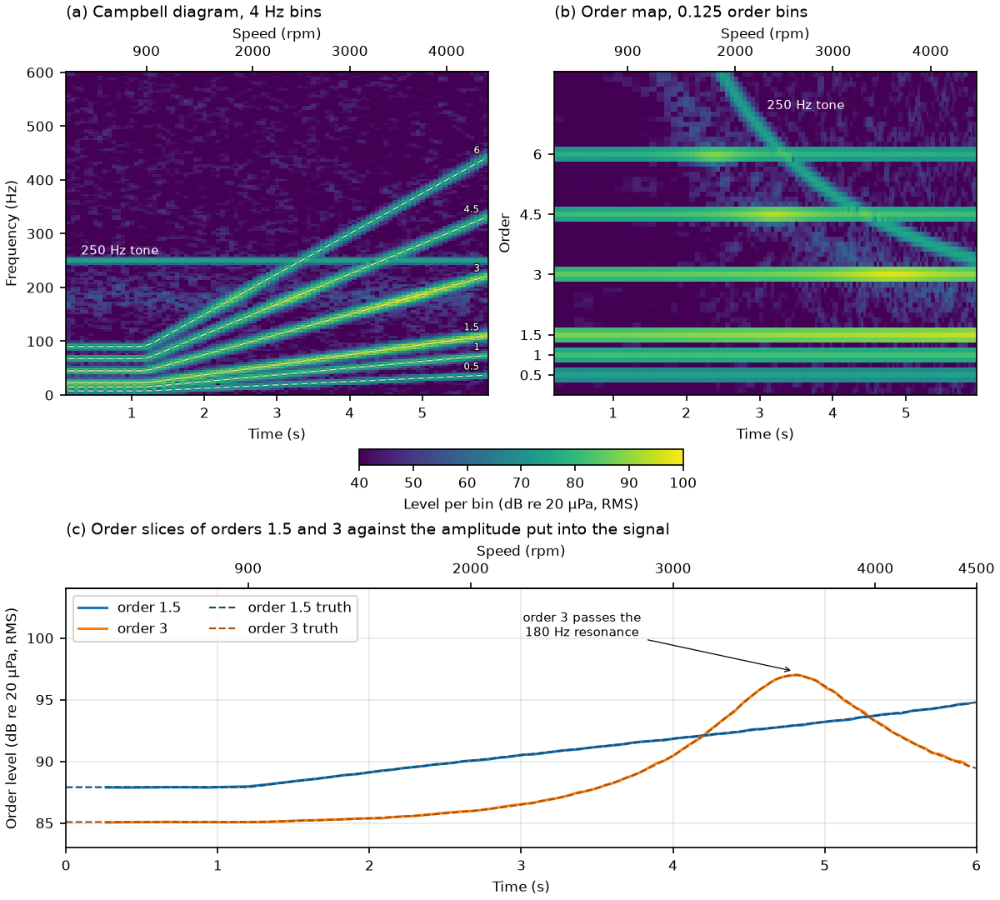
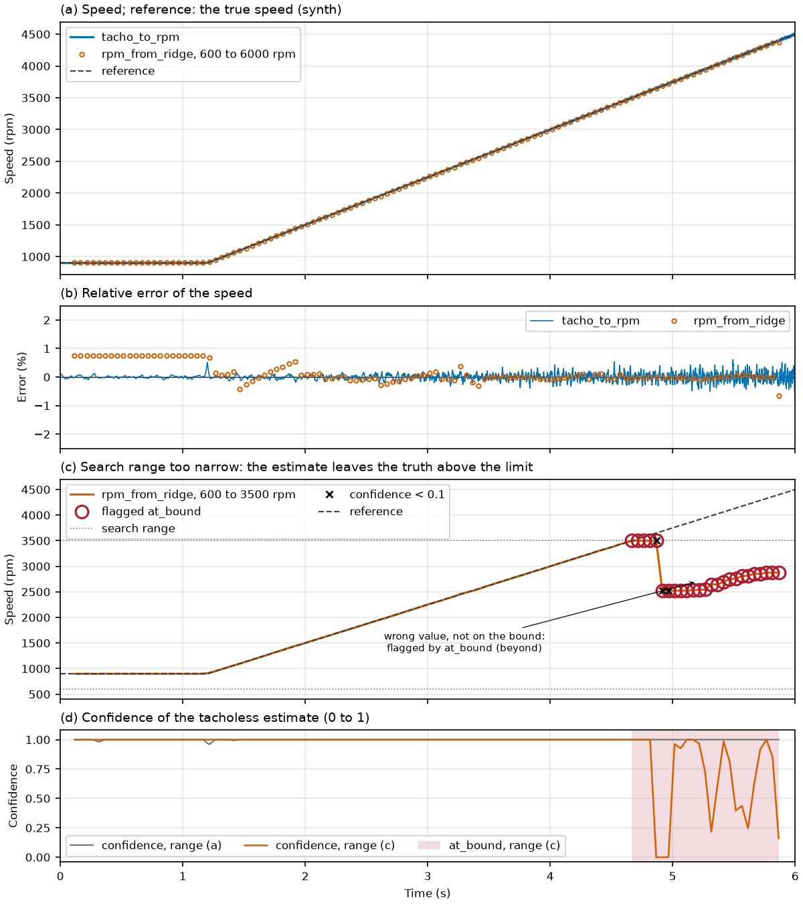
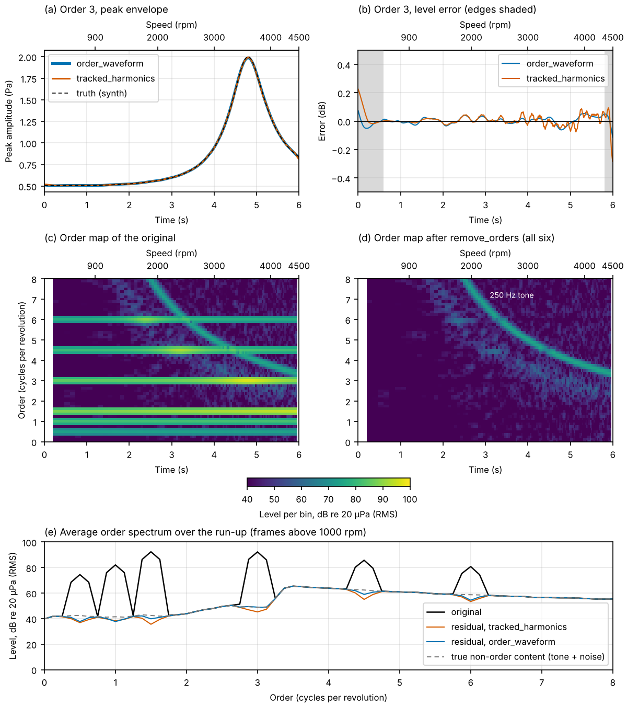
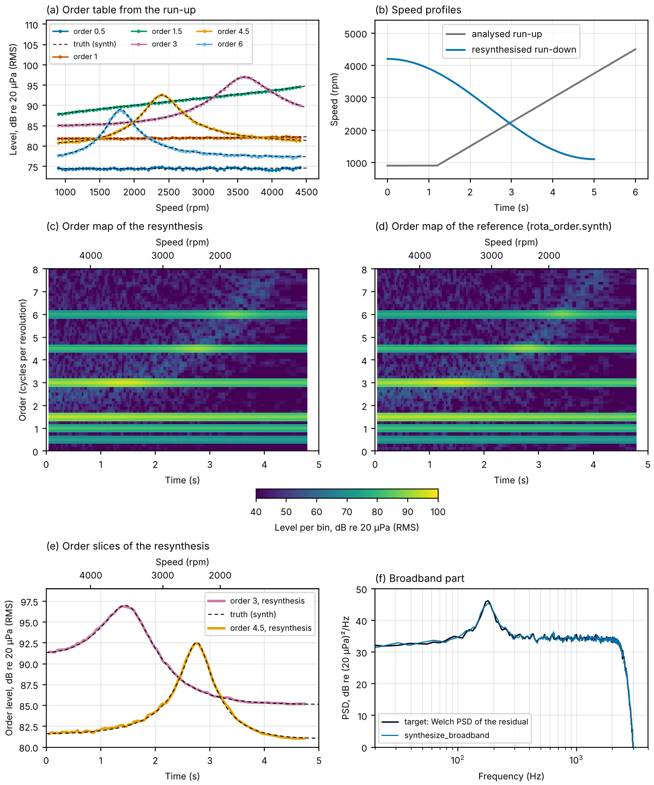
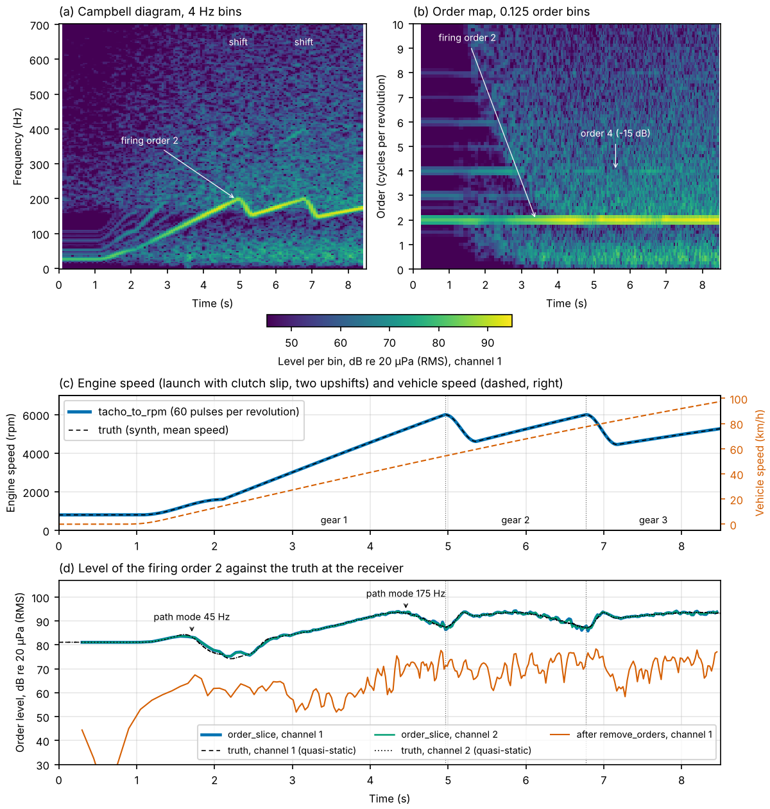
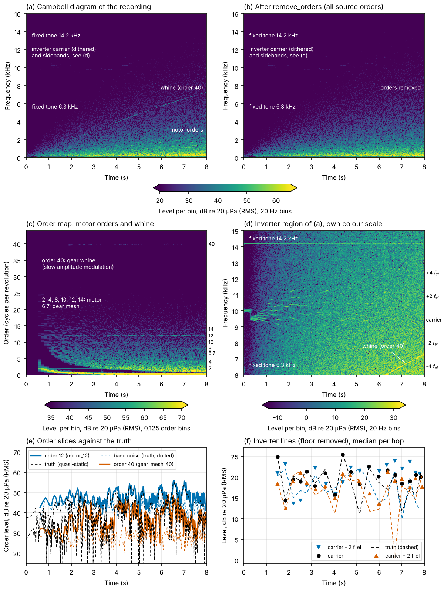
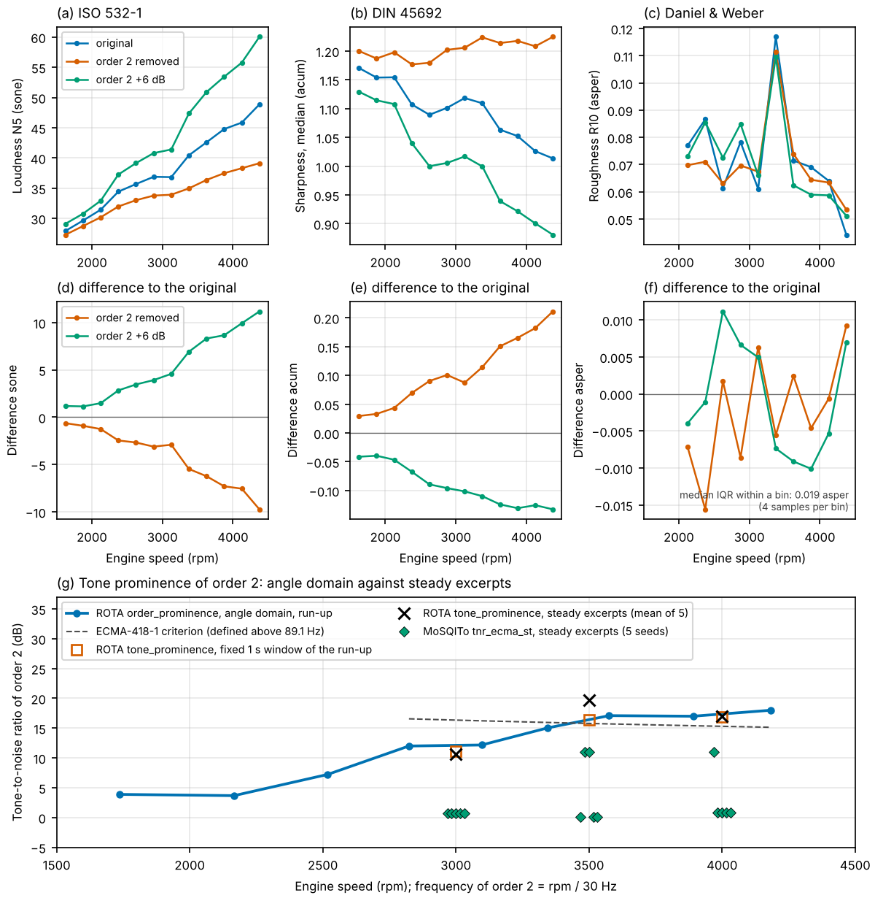
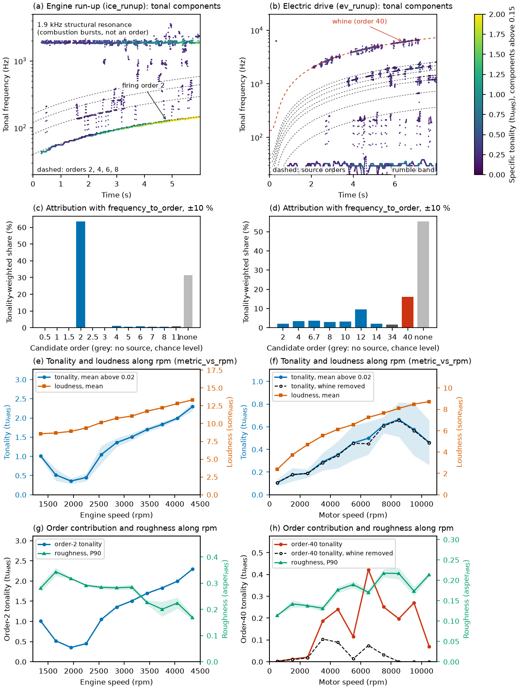
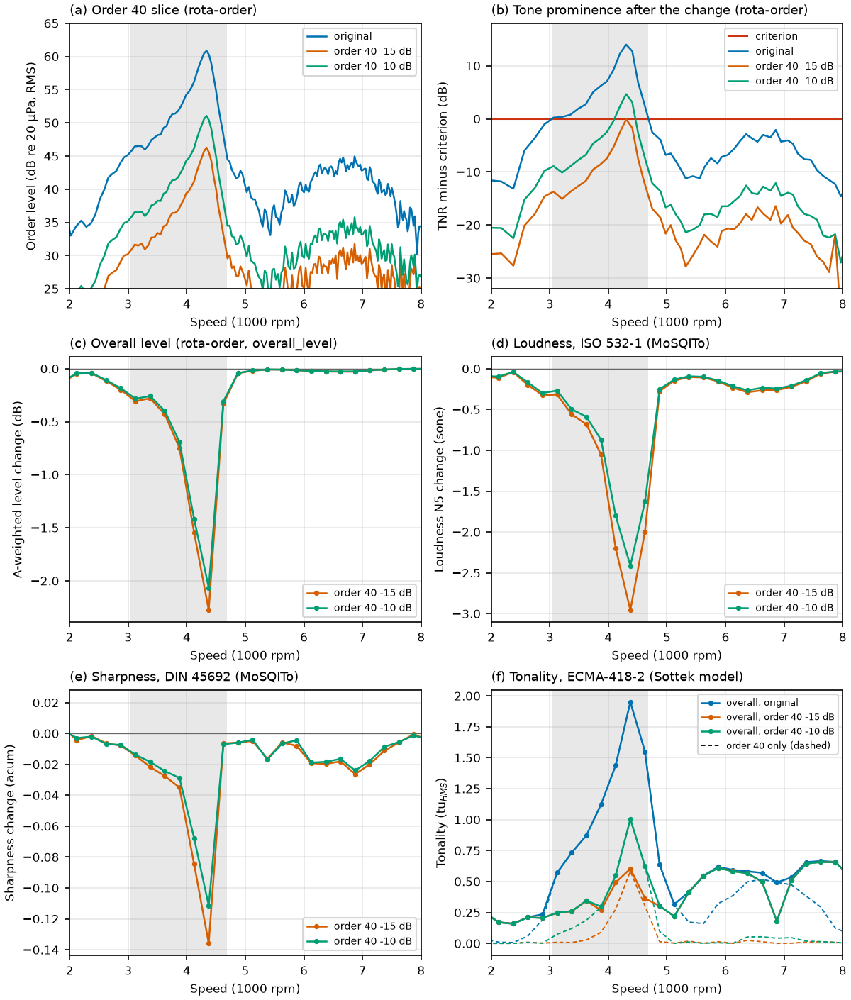
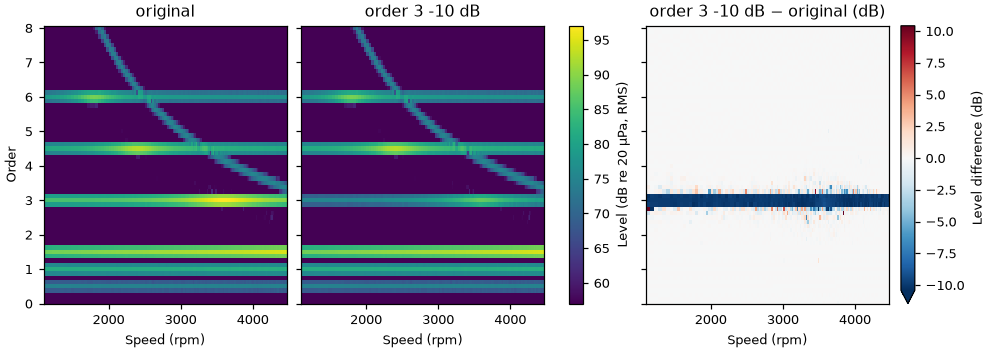

# Examples

Runnable scripts that show the main parts of ROTA on synthetic signals: six on ROTA alone (01 to 06), three bridges to open-source psychoacoustic toolboxes (07 to 09), which are optional, external dependencies (07 and 08 call them through `rota.bridges`), a worked analysis from recording to engineering conclusion (10, narrated in [docs/worked_example.md](../docs/worked_example.md)), and a gallery of the figures of `rota.plot` (11, shown in [docs/plotting.md](../docs/plotting.md)). All data come from `rota.synth`, so every result can be compared with the analytic truth that went into the signal, and scripts 1 to 10 print those comparisons as numbers before they save their figures. Scripts 5 and 6 also write WAV files that you can listen to.

## Running

Matplotlib is needed for the figures only (the library itself depends on NumPy and SciPy); scripts 1, 2 and 11 draw with `rota.plot`, the others with Matplotlib directly. From the repository root:

```
pip install -e ".[plot]"
python examples/01_order_map.py
python examples/02_tacho_and_tacholess_speed.py
python examples/03_order_extraction.py
python examples/04_order_table_resynthesis.py
python examples/05_realistic_engine_audio.py
python examples/06_electric_drive_audio.py
python examples/07_mosqito_bridge.py
python examples/08_sottek_hearing_model_bridge.py
python examples/10_worked_analysis.py
python examples/11_plot_gallery.py
```

The bridges need their toolbox, which the extra of the same name installs: `pip install -e ".[mosqito]"` for script 7 (MoSQITo, Apache-2.0, with the matplotlib its import needs) and `pip install -e ".[sottek-hearing-model]"` for script 8 (sottek-hearing-model, AGPL-3.0-only, Python 3.11 or later; mind its licence). The scripts call them through `rota.bridges`, which imports a toolbox only inside the function that needs it, so ROTA itself does not depend on either. Example 9 runs SQAT in MATLAB and is described in its own folder. Script 10 uses both toolboxes when they are installed and skips those parts otherwise.

The scripts can be started from any directory. Each runs in a few seconds (about 2 s, 2 s, 8 s, 5 s, 11 s and 25 s; script 11 about 5 s) and writes its figure to `docs/images/`, 8 inches wide at 150 dpi (the gallery figures of script 11 are about 6 inches wide at 110 dpi, the `compare_maps` figure 9 inches); scripts 5 and 6 also write their WAV files to `docs/audio/` (`scipy.io.wavfile`). Random elements use fixed seeds, so the numbers, figures and audio files are reproducible.

## The signal

Scripts 1 to 3 use the same 6 s signal at 8 kHz: an idle at 900 rpm for 1.2 s, then a linear run-up to 4500 rpm. It contains six orders (0.5, 1, 1.5, 3, 4.5 and 6, so that half orders are present), a structural resonance at 180 Hz that amplifies whichever order passes through it, a fixed 250 Hz tone and white noise. The signal is read as sound pressure in Pa; levels are in dB re 20 uPa, and the reference pressure is a named constant in each script. Amplitude conventions are stated in each script: order maps, slices and spectra are RMS, extractor envelopes and synthesised sinusoids are peak.

## 01_order_map.py

Builds the Campbell diagram (`rpm_frequency_map`) and the order map (`rpm_order_map`) of the signal and reads two order slices (`order_slice`) from the order map. In the Campbell diagram the orders are rays and the tone is a horizontal line, but at idle the half orders merge, because a fixed-length time window spans several of them. In the order map the orders are horizontal lines and stay separated at idle; the tone bends into a hyperbola and each order brightens where it passes the resonance. The slices of orders 1.5 and 3 are compared with the amplitude put into the signal, including the passage of order 3 through the resonance. The script prints the slice error in dB for all six orders (idle, run-up median and run-up maximum). It uses an order resolution of 0.125, which is what separates orders half an order apart; frames in which the fixed tone lies inside an order's band are left out of the statistics. The panels are drawn with `rota.plot` (`rpm_frequency_map` with the orders marked, `rpm_order_map`, and `order_slice` with one `truth=` curve per order), against time with a speed axis on top, because the frames of the idle hold would collapse onto one speed on an rpm axis; the shared colour bar, the speed axis and the annotations are plain Matplotlib.



Figure: `docs/images/01_order_map.png`.

## 02_tacho_and_tacholess_speed.py

Compares two speed estimates with the true speed. The signal gets a 12-pulse tachometer with timing jitter and dropped pulses, which `tacho_to_rpm` converts to rpm. `rpm_from_ridge` estimates the speed from the signal alone, with a comb of the half-order family (1.5, 3, 4.5, 6) and without spectral whitening, because the fixed tone would otherwise briefly outscore the orders at a speed above the search range (the comments in the script explain both). The figure shows the speed curves, their relative errors, and a second tacholess run whose search range is deliberately too narrow: above the upper limit the estimate does not sit on the bound but jumps to a wrong value, and `at_bound` flags every one of those frames. The script prints the speed errors, the number of pulses filled in, and how many frames of the narrow run were flagged. The speed panels are drawn with `rota.plot`: `rpm_vs_time` for the tachometer speed and `rpm_from_ridge` for the tacholess track, which marks the frames flagged `at_bound` (at or beyond a search bound) with open dark-red circles and those of low confidence with black crosses, and draws the search range; the relative errors and the confidence are plain Matplotlib, as `rota.plot` has no figure for them.



Figure: `docs/images/02_tacho_and_tacholess_speed.png`.

## 03_order_extraction.py

Extracts the six orders with the Vold-Kalman filter (`order_waveform`) and with phase-locked tracked harmonics (`tracked_harmonics`), after `resolution_check` has confirmed that the settings separate half orders at idle. The figure compares the peak envelope of order 3 with the truth for both extractors and shows the level error. It then removes all six orders (`remove_orders`) and shows the order map before and after, and the average order spectrum of the original, of both residuals and of the true non-order content (tone and noise), which is what an ideal removal would leave. The script prints envelope errors and waveform correlation per order, and the energy left at each removed order (`order_residual_energy`). The extractors do not know about the fixed tone, so orders 4.5 and 6 pick it up briefly where they cross it; those frames are left out of the error statistics, and the true non-order content serves as the floor for the residual energy.



Figure: `docs/images/03_order_extraction.png`.

## 04_order_table_resynthesis.py

Analyses a run-up and builds a different signal from the analysis alone. The orders are read from an order map and binned into an order table (`OrderTable.from_slices`), which `synthesize_orders` renders along another speed profile, an S-shaped run-down from 4200 to 1100 rpm. The broadband part comes from the Welch PSD of the residual left by `remove_orders`, rendered with `synthesize_broadband`. The sum is analysed again and compared with a reference made by `rota.synth` along the same run-down. The figure shows the table, the two speed profiles, the order maps of the resynthesis and of the reference, two order slices, and the target and synthesised broadband PSD. The script prints the order-level errors of the resynthesis against the table (round trip) and against the reference, the level and PSD match of the broadband part, and the total level. This script uses the signal without the fixed tone: a fixed line is neither an order nor broadband noise, and in the residual PSD it would be a spike narrower than the envelope resolution of the broadband synthesiser. In an order table it belongs in its own row, with order 0 and a `freq_offset`.



Figure: `docs/images/04_order_table_resynthesis.png`.

## Audio: one scaling for every file

Scripts 5 and 6 write 16-bit PCM WAV files at 32 kHz. The only digital scaling is the constant `FULL_SCALE_PA = 4.0` in both scripts: a sound pressure of 4 Pa maps to digital full scale, and every file (recording, residual, extracted orders, resynthesis) uses it, so the levels of all files can be compared directly. A raised-cosine fade of 20 ms at both ends is the only other change; there is no normalisation or limiter, and a script stops with an error instead of writing a file that would clip. The recordings are synthetic: every parameter is a default of `rota.synth.synth_scenario` or an override stated in the script.

## 05_realistic_engine_audio.py

A complete synthetic recording, `synth_scenario("ice_runup")` with two receiver channels: a four-stroke four-cylinder engine (firing order 2) pulls away from idle with clutch slip and accelerates at full load through two upshifts in 8.5 s. The default record starts in second gear; the launch comes from the overrides in the script (`speed`: 0.8 s hold from 0 km/h at 4 m/s², `drive`: start in first gear). Order 2 dominates, orders 4, 6 and 8 follow at -15, -24 and -30 dB, the odd and half orders are weaker. The scenario adds an angle-locked speed ripple, combustion bursts ringing a 1.9 kHz structural resonance, engine broadband noise, road noise and a low-frequency rumble, a road-joint thump and a click, a modal transfer path (humps at 45 and 175 Hz, a dip near 80 Hz) and a cabin impulse response. The script reads the speed from the tachometer channel (`tacho_to_rpm`, with the conditioning delay compensated), draws the Campbell diagram and the order map, and compares the slice of the firing order with the quasi-static truth at each receiver. It removes 27 engine orders with tracked harmonics (the source orders of the scenario and the harmonics of the firing order up to order 40, which carry the periodic part of the combustion bursts), compares the extracted orders and the residual with the true stems, and renders the extracted orders along a speed 15 % higher (`remap_rpm`, envelopes keep their time course) before recombining them with the residual (`resynthesize`). The residual is quieter than the true non-engine content, because the order bands also take the broadband noise inside them; the script prints both levels. Printed results: tacho speed error median 0.015 %, firing-order slice within 0.23 dB of the truth (median, both channels), extracted orders against the true engine stems corr 0.98, residual 80 dB against 82 dB of true non-engine content.

Audio: `docs/audio/engine_runup.wav` (the recording), `engine_runup_orders_removed.wav` (the residual), `engine_runup_orders_only.wav` (the extracted orders) and `engine_runup_faster.wav` (the faster engine), all stereo.



Figure: `docs/images/realistic_runup.png`.

## 06_electric_drive_audio.py

A synthetic electric drive, `synth_scenario("ev_runup")` shortened to 8 s: a motor with four pole pairs behind a single-speed 12:1 reduction accelerates at full load from walking pace (200 to about 10900 rpm). The source orders are the motor order family 2, 4, 8, 10, 12 and 14 (order 4 is the electrical frequency), a gear-mesh order 6.7 and the gear whine at order 40 with a slow amplitude modulation. The inverter carrier at 10 kHz is dithered by up to ±0.8 kHz in hops, with sidebands at plus and minus 2 and 4 times the electrical frequency only 2 to 4 dB above the local floor; two fixed tones sit at 6.3 and 14.2 kHz. The tonal lines are weak against the road noise and the low-frequency rumble, as in a quiet electric vehicle. The only overrides are the duration and a 24-pulse tachometer (the default 48 pulses would be shorter than 2 samples at 32 kHz above 10000 rpm).

The figure shows the Campbell diagram before and after order removal, the order map with the motor order family and the whine, and the inverter region with its own colour scale, where the carrier hops and the sideband fan are visible. The script compares every order slice with the quasi-static truth where the line stands at least 6 dB above the true noise in its order band: the whine does so in about two thirds of the frames, most motor orders rarely (their bands are dominated by road noise, which the script prints per order). It reads the carrier and its sidebands from the Campbell diagram along their true dithered tracks with the local floor subtracted (median per hop: carrier within 0.9 dB of the truth, ±2 f_el sidebands within 1.4 to 2.1 dB, ±4 f_el within 3 to 4 dB). Order removal uses tracked harmonics in two passes: the whine with 4 revolutions, which follow it through the 2.1 and 3.3 kHz path modes (corr 0.89 with its true stem), then the motor and gear-mesh orders with 16 revolutions, whose narrow bands take less road noise along. The inverter sidebands are not orders (their frequency is not proportional to the speed), so they stay in the residual. The sampling rate is checked to be at least 2.2 times the highest carrier frequency.

Audio: `docs/audio/electric_runup.wav` (the recording), `electric_runup_motor_orders_removed.wav` (inverter, tones, road noise and rumble) and `electric_runup_whine_only.wav` (the extracted motor and gear orders, about 28 dB below the recording), all mono.



Figure: `docs/images/electric_drive.png`.

## 07_mosqito_bridge.py

Links ROTA to MoSQITo (Apache-2.0, `pip install -e ".[mosqito]"` or `pip install mosqito`, tested with PyPI 1.2.1, repository github.com/Eomys/MoSQITo), which computes the psychoacoustic metrics that ROTA leaves out of scope, through `rota.bridges.mosqito`. MoSQITo is an optional, external dependency: ROTA does not depend on it and does not vendor or copy it, the bridge imports it only inside its functions and calls only documented public functions, and without the package the script stops with the install message and `tests/test_bridge_mosqito.py` is skipped. The functions and the standards behind them, as catalogued at zhenxianli.github.io/LISQM: `loudness_zwtv` (ISO 532-1:2017, time-varying; `bridges.mosqito.loudness`), `sharpness_din_from_loudness` (DIN 45692; `bridges.mosqito.sharpness`), `roughness_dw` (Daniel & Weber; `bridges.mosqito.roughness`) and `tnr_ecma_st` (the ECMA-74 Annex D tone-to-noise ratio, catalogued against ECMA-74:2019). The script calls `tnr_ecma_st` directly: `rota.bridges` does not wrap it, because ROTA has its own tone-to-noise ratio (ECMA-418-1:2024, `rota.tonal`), and the script compares the two. MoSQITo's ECMA-418-2 functions (`loudness_ecma`, `roughness_ecma`) are the 2nd edition (2022) only, not the current 4th edition; the script does not use them and `rota.bridges` does not wrap them.

The signal is the first 6 s of the seeded `synth_scenario("ice_runup")` (1200 to 4400 rpm, one receiver channel, before the first upshift). ROTA gives the speed from the tachometer with `tacho_to_rpm` (median error 0.014 %). The bridge takes the signal in Pa at 32 kHz and brings it to the 48 kHz that MoSQITo needs with `to_calibrated_48k` (the level is unchanged, 86.79 dB re 20 uPa before and after, which the script checks). MoSQITo computes loudness, sharpness and roughness, and the `vs_rpm` method of each result bins it in 250 rpm bins on the run-up (with `metric_vs_rpm`), using the start-up exclusion and the aggregation that the bridge recommends for the metric: 0.6 s skipped for loudness and sharpness, 1.5 s for roughness; the 95th percentile of loudness (N5), the median of sharpness and the 90th percentile of roughness (R10). In one line: `bridges.mosqito.loudness(x, fs).vs_rpm(rpm, t, bins=edges, min_count=3)`. The metrics are never averaged in dB.

The order contribution comes from two more signals made with ROTA: order 2 removed with `remove_orders` (tracked harmonics, 8 revolutions) and order 2 raised by 6 dB (`modify_orders` on the extracted components, `resynthesize` with the unchanged residual). The script checks them before MoSQITo sees them: the order-2 slice drops by 25.8 dB and rises by 6.0 dB (median, RMS), the A-weighted level changes by -1.4 and +2.7 dB. The figure and the printed table give the differences along rpm. Removing order 2 lowers the N5 loudness by 2.5 sone at 2400 rpm and 9.7 sone at 4400 rpm (+2.8 and +11.2 sone for the raised order) and raises the sharpness by 0.03 to 0.21 acum (the raised order lowers it by 0.04 to 0.13 acum): order 2 carries much of the loudness and, being low in frequency, keeps the sound less sharp. The roughness change is below the scatter of a bin (a few 0.1 s frames per bin, interquartile range 0.02 asper against changes of 0.01), so the example draws no conclusion on the contribution of order 2 to roughness.

The last part compares the tone prominence of order 2. ROTA's `order_prominence` works in the angle domain: frames of 50 revolutions keep order 2 a stationary line although the speed rises by 500 rpm/s, and the critical band of each frame is evaluated at its mean speed (ECMA-418-1, 3rd edition, 2024). MoSQITo's `tnr_ecma_st` has no speed input; it takes a signal of fixed duration as one spectrum and detects the tones itself, so it is run on five steady 2 s excerpts (`stationary_excerpt`) at each of three speeds, next to ROTA's `tone_prominence` on the same excerpts. A fixed 1 s window cut from the run-up would let order 2 sweep 17 to 18 Hz, 17 to 18 % of the critical band, which the standard no longer calls resolved (the table flags it). Results: ROTA's angle-domain TNR of order 2 rises from 12.1 to 17.4 dB between 3000 and 4000 rpm and lies within 3.5 dB of ROTA's value on the steady excerpts (10 to 20 dB; the excerpt is a resynthesis, not the recording). MoSQITo agrees with ROTA within 1.5 dB in none of the 15 excerpts: it returns 0.1 to 1 dB in 12 of them and 11 dB in 3. On a steady tone in noise with an exact spectrum the two agree within about 0.5 dB from 130 Hz to 4 kHz (the test), and with Gaussian noise MoSQITo 1.2.1 gives 2 to 3 dB instead of the right value for about half of the tones between 130 and 380 Hz. MoSQITo is catalogued against ECMA-74:2019, whose method is that of the 2nd edition of ECMA-418-1, and the 3rd edition followed by ROTA changed the tone band and the noise estimate, which may explain part of the difference; we have not investigated MoSQITo's implementation.

The figure shows loudness, sharpness and roughness along rpm for the three signals and their differences to the original (a to f), and the tone-to-noise ratio of order 2 along rpm: ROTA in the angle domain with the criterion, ROTA on a 1 s window, ROTA and MoSQITo on the steady excerpts (g). Run time is about 50 s on four cores (the three signals are processed by MoSQITo in parallel processes, about 2 min on one core).



Figure: `docs/images/07_mosqito_bridge.png`.

## 08_sottek_hearing_model_bridge.py

Links ROTA to the Python implementation of the Sottek hearing model of ECMA-418-2, the package `sottek-hearing-model` (import name `sottek_hearing_model`, tested with PyPI 0.1.14, repository github.com/mlotinga/sottek-hearing-model). It implements ECMA-418-2:2025 (4th edition) tonality (with the frequency of the dominant tonal component), loudness and roughness; fluctuation strength is not in the released package yet, so it is not used. The package is an optional external dependency: it is licensed AGPL-3.0-only (package metadata), needs Python 3.11 or later and pulls in PyQt6 and Matplotlib; install it only if you accept that licence (`pip install -e ".[sottek-hearing-model]"` or `pip install sottek-hearing-model`). The script calls it through `rota.bridges.sottek_hearing_model`: ROTA does not depend on it and does not vendor or copy it, the bridge imports it only inside its functions (and undoes the change of Matplotlib's settings that the import makes) and calls only its documented functions `shm_tonality_ecma`, `shm_loudness_ecma_from_comp` and `shm_roughness_ecma`. Without the package the script stops with the install message, and the test `tests/test_bridge_shm.py` is skipped.

The script analyses two seeded `rota.synth.synth_scenario` records, mono at 32 kHz: `"ice_runup"` (6 s from 1200 rpm, before the first upshift) and `"ev_runup"` (8 s, 190 to 10900 rpm, with the whine at order 40). The speed comes from the tachometer (`tacho_to_rpm`). The bridge takes the pressure in Pa at 32 kHz (calibration factor 1, the default, because the signal is already in Pa) and brings it to the model's 48 kHz with `rota.tonal.to_calibrated_48k`. The `vs_rpm` method of each result bins the model's time-dependent tonality, loudness and roughness along rpm (with `metric_vs_rpm`) as the bridge recommends: tonality as the mean of the frames above 0.02 tu_HMS (the threshold ECMA-418-2 uses for its single value; the frames below are discarded), loudness as the arithmetic mean, roughness as the 90th percentile, after the model's own start-up exclusions (0.30 s for tonality and loudness, 0.31 s for roughness). The model puts its last tonality and loudness frame at the signal length rounded up to a multiple of 256 samples at 48 kHz (for these 6 s and 8 s records exactly one sample after the last speed sample), and `vs_rpm` gives it the last speed. With one bin over the whole run `vs_rpm` reproduces the package's `tonality_avg` and `roughness90pc` (the `single_value` of the results) to printed precision (engine 1.2817 tu_HMS and 0.3090 asper_HMS, drive 0.4217 and 0.2007), so the per-bin values are those single values restricted to a speed bin. The package's `loudness_powavg` (the `single_value` of the loudness) is a power average and differs from the arithmetic mean (engine 11.04 against 10.78 sone_HMS), so the script prints both.

The frequencies of the tonal components (the specific tonality of each half band and its tonal frequency come with the tonality result, in its `extra`) go through `frequency_to_order` and `order_share` with a 10 % window. That is wide because the model reads frequency coarsely in its lowest bands: the firing frequency of the engine reads 7 % low below 50 Hz and 1.3 % low above 70 Hz. An order without a source (11 for the engine, 34 for the drive) gives the chance level, about 1 to 2 %. For the engine, the dominant tonal frequency of the overall tonality lies on order 2 in 98.6 % of the 1069 tonal frames (orders 4 to 16 collect less than 0.05 % of them); counted over all half-band components weighted by specific tonality, order 2 holds 63.5 % and the unattributed rest includes the combustion-burst resonance at 1.9 kHz, which is not an order (panel a). The overall tonality of the electric drive is the largest specific tonality of the bands and follows the low-frequency rumble band at about 31 Hz (the whine holds 3.7 % of the dominant frames); in the half-band components the whine holds 16.1 %, order 12 (the broad resonance) 9.5 %, and the other motor orders 2 to 4 % each. Removing the whine with `remove_orders` (tracked harmonics, 4 revolutions) and running the model again lowers its share to 2.4 % and the order-40 tonality averaged over the speed bins from 0.163 to 0.031 tu_HMS, while the overall tonality changes by only 2 % (0.422 to 0.413 tu_HMS): the whine is audible as a tone but does not set the overall tonality of this record. The engine's tonality along rpm is the order-2 tonality, with a minimum of 0.36 tu_HMS near 2000 rpm and 2.3 tu_HMS at 4350 rpm; the printed table lists tonality, loudness, roughness and the order-attributed tonality for every speed bin.

The figure shows the model's tonal components against time with the order lines (a, b), the attribution to candidate orders with the control order (c, d), tonality and loudness along rpm, with the tonality without the whine (e, f), and the order-attributed tonality with and without the whine together with the roughness (g, h). Run time is about 2 minutes on four cores; the model dominates, it uses all cores but one by default, and with `PARALLEL_CORES = 1` it takes about three times longer.



Figure: `docs/images/08_sottek_hearing_model_bridge.png`.

## 09_sqat_bridge/

Links ROTA to SQAT (MATLAB, GPL-3.0 as a whole, github.com/ggrecow/SQAT, release v2.0 pinned to a commit). `export_signals.py` writes the two seeded run-ups (`ice_runup` and `ev_runup`) as calibrated pressure in Pa at 48 kHz with their speed; `run_sqat.m` computes ISO 532-1 loudness, DIN 45692 sharpness, Daniel & Weber roughness and ECMA-418-2 tonality with SQAT; `import_results.py` bins them along rpm with `metric_vs_rpm`. It runs in GitHub Actions (`.github/workflows/sqat-bridge.yml`), where SQAT is cloned at run time; its results stay in the workflow artifacts and are not committed. On your own machine, with a licensed MATLAB and the MATLAB Engine API for Python, `rota.bridges.sqat` makes the same calls from Python. Details, the calls and their parameters: [09_sqat_bridge/README.md](09_sqat_bridge/README.md).

## 10_worked_analysis.py

One analysis from the raw signal to an engineering conclusion, written up step by step in [docs/worked_example.md](../docs/worked_example.md). The signal is `synth_scenario("ev_runup")` (8 s at 32 kHz, seeded) with one problem built in and stated in the script: a structural resonance at 2900 Hz in the transfer path, which the gear whine (order 40) passes at 4350 rpm, and a cabin without diffuse-field fading so that the resonance is not hidden. The script does not use that knowledge. It prepares the speed (`tacho_to_rpm`, checked against the tacholess `rpm_from_ridge`), gives the overview (`overall_level`, `band_levels_vs_rpm`, `rpm_order_map`), finds candidate orders in the order spectrum, and decides between them with `order_slice`, `order_share` and `order_prominence` (TNR and PR against `prominence_criterion`, ECMA-418-1 3rd edition). It extracts the culprit with the Vold-Kalman filter (bandwidth checked with `resolution_check`), lowers it with `modify_orders` and `resynthesize`, and analyses the new signals again. With the optional packages it adds ISO 532-1 loudness and DIN 45692 sharpness (MoSQITo, `pip install -e ".[mosqito]"`) and ECMA-418-2 tonality (`sottek-hearing-model`, AGPL-3.0-only, Python 3.11 or later, `pip install -e ".[sottek-hearing-model]"`), computed through `rota.bridges` and binned along rpm by the `vs_rpm` method of each result, with the start-up exclusion and the aggregation that the bridge recommends; without a package the script runs and says which part it skipped.

Printed results, each next to the truth: order 40 is the only candidate above its criterion; its TNR exceeds the criterion between 3034 and 4685 rpm and by more than 6 dB between 3846 and 4530 rpm (truth from the stems: 3365 to 4664 and 3856 to 4505 rpm), with a maximum of +14.0 dB at 4304 rpm (truth +13.5 dB at the same bin; the resonance is at 4350 rpm); a reduction of 15 dB brings it under the criterion and 10 dB does not. In the range that lowers the A-weighted level by 1.05 dB, the loudness N5 by 8.6 % and the tonality by 69 %. Run time about 2 minutes on four cores with both packages, about 25 s without. `tests/test_worked_example.py` runs the analysis chain on the first 3.6 s of the same signal.

Audio (48 kHz, mono, 8 s, the same `FULL_SCALE_PA` as scripts 5 and 6): `docs/audio/worked_original.wav`, `worked_order40_minus15db.wav` and `worked_order40_minus10db.wav`.



Figures: `docs/images/10_worked_overview.png`, `10_worked_diagnosis.png` and `10_worked_whatif.png`.

## 11_plot_gallery.py

One figure for each of the 15 functions of `rota.plot`, written to `docs/images/plot_<function>.png` and shown with the call that drew it in [docs/plotting.md](../docs/plotting.md). The signal is the run-up of scripts 1 to 3 without the idle hold (1000 to 4500 rpm), so that `x="auto"` draws the maps against speed. A modified signal, with order 3 lowered by 10 dB (`modify_orders` and `resynthesize`), gives the before/after figures: `compare_maps` with the level difference, `overall_level` with two entries, and an order slice drawn `relative_to` the original (one more figure, `plot_order_slice_relative_to.png`). No psychoacoustic toolbox is needed: `metric_vs_rpm` and `time_metric` draw a `rota.bridges.TimeMetric` made by hand from the A-weighted Fast level computed by ROTA (`rota.tonal.level_vs_time`). Level plots use `**rp.SOUND_PRESSURE` (dB re 20 µPa). The script prints only the names of the files it writes.



Figures: `docs/images/plot_*.png` (16 files).
